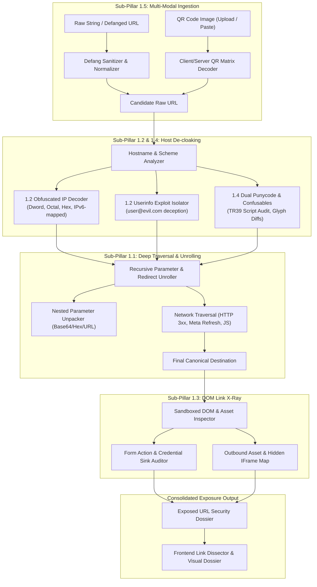

# Pillar 1 Implementation Plan: Total URL Exposing & De-obfuscation

## 1. Executive Summary & Objective

Pillar 1 addresses the primary adversarial tactic in modern phishing and malware distribution: **evasion through obfuscation**. Attackers rarely provide plain, directly readable URLs leading straight to malicious payloads. Instead, they leverage:
- Multi-tier redirectors and URL shorteners
- Open redirect parameters nested inside trusted enterprise domains
- Alternative IP encoding formats (Hex, Octal, Dword, mixed-base)
- Userinfo syntax exploitation (`user:pass@host`)
- IDN homographs with mixed-script Unicode glyphs
- QR code image encapsulation ("Quishing")
- Hidden form actions and off-origin exfiltration sinks

The objective of **Pillar 1: Total URL Exposing & De-obfuscation** is to strip away every deception layer, exposing the true landing destinations, intermediate traversal hops, structural anomalies, and destination data sinks before the user or downstream threat detection engines evaluate risk.

---

## 2. Pillar 1 Sub-Pillar Feature Architecture



---

## 3. Sub-Pillar Implementation Specifications

Detailed engineering specifications are organized into consolidated architectural documents for each pillar:

| Pillar | Specification Document | Primary Scope | Core Codebase Touchpoints |
| :--- | :--- | :--- | :--- |
| **Pillar 1** | [`pillar-1-url-exposing-and-deobfuscation.md`](file:///home/temesgensida/tom/django_react/zeb/docs/implementation/features/pillar-1-url-exposing-and-deobfuscation.md) | Sub-pillars 1.1–1.5: Recursive parameter unrolling, numeric IP decoding, Link X-Ray form audits, TR39 IDN confusables, and QR/defanged ingestion | `redirect_chain.py`, `common.py`, `structure.py`, `sandbox_preview.py`, `views.py` |
| **Pillar 2** | [`pillar-2-multi-engine-threat-intel.md`](file:///home/temesgensida/tom/django_react/zeb/docs/implementation/features/pillar-2-multi-engine-threat-intel.md) | Multi-feed threat intel (Google Safe Browsing, URLhaus, VirusTotal) with zero-panic circuit breakers and TTL caching | `threat_intel/` package, `views.py` |
| **Pillar 3** | [`pillar-3-infrastructure-network-dns.md`](file:///home/temesgensida/tom/django_react/zeb/docs/implementation/features/pillar-3-infrastructure-network-dns.md) | Fast-Flux DNS via DoH, DDNS/tunnel filters, ASN/BGP reputation, MX/SPF email auditing, and deep SSL/CT recency | `infrastructure/` package, `structure.py`, `views.py` |
| **Pillar 4** | [`pillar-4-dynamic-sandboxing-visual-threats.md`](file:///home/temesgensida/tom/django_react/zeb/docs/implementation/features/pillar-4-dynamic-sandboxing-visual-threats.md) | Dynamic Playwright browser sandboxing, perceptual hash (pHash) brand matching, and differential anti-cloaking probing | `dynamic_sandbox/` package, `structure.py`, `App.jsx` |
| **Pillar 5** | [`pillar-5-deep-dom-payload-inspection.md`](file:///home/temesgensida/tom/django_react/zeb/docs/implementation/features/pillar-5-deep-dom-payload-inspection.md) | Behavioral DOM heuristics: insecure HTTP passwords, SSN/CVV/OTP harvesting, Web3 wallet drainers, and drive-by double extension traps | `dom_inspection/` package, `sandbox_preview.py`, `views.py` |
| **Pillar 6** | [`pillar-6-user-facing-security-ui-ux.md`](file:///home/temesgensida/tom/django_react/zeb/docs/implementation/features/pillar-6-user-facing-security-ui-ux.md) | Interactive Link Dissector visual anatomy bar, safe cloud screenshot & de-scripted text reader, and STIX 2.1 / Markdown incident exporters | `frontend/src/components/`, `urlTokenizer.js`, `stixGenerator.js`, `App.jsx` |
| **Pillar 7** | [`pillar-7-developer-api-and-usage-tracking.md`](file:///home/temesgensida/tom/django_react/zeb/docs/implementation/features/pillar-7-developer-api-and-usage-tracking.md) | Developer API Platform: OAuth2 (Google/GitHub), hashed API keys, 60/min rate limiting, 1,000/day quotas, usage metering, and third-party API isolation | `ApiKey`, `ApiUsageLog`, `authentication.py`, `throttling.py`, `api_views.py`, `/developer` |

---

## 4. Cross-Cutting Standards & Architecture Constraints

### 4.1 SSRF & Network Security Safeguards
When expanding URLs, unrolling redirects, or downloading QR payloads, the backend must **never** touch internal network interfaces:
- **Private Subnets Blocked**: `127.0.0.0/8`, `10.0.0.0/8`, `172.16.0.0/12`, `192.168.0.0/16`, `169.254.169.254` (cloud metadata), `fc00::/7` (IPv6 ULA), `fe80::/10` (link-local).
- **DNS Pinning**: Every resolved hop must perform pre-flight IP validation prior to initiating the HTTP socket connection to protect against DNS rebinding.

### 4.2 Latency & Resource Budgets
- **Parameter Unrolling**: Purely static; runtime budget $< 5\text{ms}$.
- **Network Redirect Traversal**: Strict per-hop timeout ($2.0\text{s}$), max hops limit ($10$), total redirect budget $< 6\text{s}$.
- **HTML Parsing**: Max body limit $1.0\text{ MB}$, streaming parser stops immediately upon extracting required metadata.
- **Client-Side QR Decoding**: Performed entirely in the browser using WebAssembly / Canvas when possible ($< 100\text{ms}$) to preserve server resources.

### 4.3 Unified Response Contract Integration
All Pillar 1 features contribute to an expanded `urlExposure` field in the primary API response of `UrlSafetyCheckView`:

```json
{
  "url": "https://deobfuscated-canonical.com/login",
  "rawInput": "hxxps[://]0x7f.1@legit.org/out?url=aHR0cHM6Ly9iaXQubHkvZXhhbXBsZQ==",
  "verdict": "UNSAFE",
  "exposure": {
    "originalInputType": "DEFANGED_URL",
    "hostAnalysis": {
      "rawHost": "0x7f.1@legit.org",
      "canonicalHost": "127.0.0.1",
      "userinfoDeception": {
        "detected": true,
        "deceptivePrefix": "0x7f.1",
        "targetHost": "legit.org"
      },
      "ipEncoding": {
        "isObfuscated": true,
        "format": "HEX",
        "decodedIp": "127.0.0.1"
      },
      "idn": {
        "isIdn": false,
        "punycode": "127.0.0.1",
        "unicode": "127.0.0.1",
        "hasMixedScript": false,
        "confusableGlyphs": []
      }
    },
    "traversal": {
      "initialUrl": "http://127.0.0.1/out?url=aHR0cHM6Ly9iaXQubHkvZXhhbXBsZQ==",
      "unrolledParameters": [
        {
          "param": "url",
          "encoding": "BASE64",
          "extractedUrl": "https://bit.ly/example"
        }
      ],
      "hops": [
        {
          "index": 1,
          "url": "https://bit.ly/example",
          "type": "SHORTENER",
          "statusCode": 301
        },
        {
          "index": 2,
          "url": "https://final-destination.xyz/login",
          "type": "TERMINAL",
          "statusCode": 200
        }
      ],
      "totalHops": 2,
      "finalUrl": "https://final-destination.xyz/login"
    },
    "linkXRay": {
      "forms": [
        {
          "action": "https://api.telegram.org/bot12345/sendMessage",
          "method": "POST",
          "hasPasswordField": true,
          "isCrossOrigin": true,
          "isExfiltrationSink": true
        }
      ],
      "externalAssetCount": 14,
      "hiddenIframesCount": 1
    }
  }
}
```

---

## 5. Implementation Roadmap & Milestones

1. **Sprint 1 (Sub-Pillars 1.1 & 1.2)**: Core backend algorithms for parameter extraction, IP decoders, and userinfo de-cloaking. Unit test validation across edge cases.
2. **Sprint 2 (Sub-Pillars 1.4 & 1.5)**: TR39 confusable detection engine, defanged input/output handlers, and frontend QR code drag-drop integration.
3. **Sprint 3 (Sub-Pillar 1.3 & UI Dossier)**: DOM Form Action auditor, exfiltration sink rules, and interactive Frontend Link Dissector.
