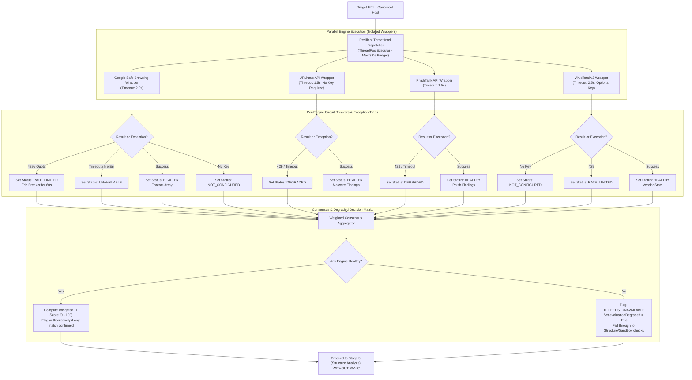

# Feature Implementation Spec: Pillar 2 Multi-Engine Threat Intelligence (TI) Integration & Zero-Panic Resiliency

## 1. Overview & Threat Context

### 1.1 Problem Statement
Currently, ZEB relies exclusively on **Google Safe Browsing API v4** as its external threat intelligence feed. This architecture introduces severe operational and security liabilities:

1. **Catastrophic Single Point of Failure (Backend Panic)**:
   - In [`backend/service/views.py`](file:///home/temesgensida/tom/django_react/zeb/backend/service/views.py#L121-L137), if the `GOOGLE_SAFE_BROWSING_API_KEY` is missing, the backend returns an immediate `HTTP 500`.
   - If Google Safe Browsing returns an `HTTP 429` (Quota / Rate-Limit Reached) or network timeout, the view raises an uncaught `RuntimeError`/`ConnectionError` and returns `HTTP 502 Bad Gateway`.
   - As a result, the entire application halts. All subsequent checks (URL structure, WHOIS domain age, redirect tracing, static sandbox preview) are blocked from executing.
2. **Zero-Hour Detection Blind Spot**:
   - Google Safe Browsing indexes threats primarily after user reports and automated crawling, which can introduce a 6-to-48 hour window of exposure for brand new phishing kits and ephemeral malware droppers.
3. **No Redundancy or Consensus**:
   - No single threat feed has 100% coverage. Attackers regularly test lures against Google Safe Browsing to verify they are not flagged before launching campaigns.

### 1.2 Target Objectives
- **Multi-Feed Defense-in-Depth**: Integrate multiple threat intelligence feeds:
  - **Google Safe Browsing v4**: Commercial baseline for malware and deceptive sites.
  - **URLhaus (Abuse.ch)**: Free, real-time community feed for active malware distribution, botnet C2s, and malicious payloads (zero API key required).
  - **PhishTank / OpenPhish**: Community-verified zero-hour phishing pages.
  - **VirusTotal v3**: Multi-vendor scanning aggregation (70+ AV/URL engines, optional key).
  - **AbuseIPDB / DNSBL**: Host reputation and fast blackhole list lookups.
- **Zero-Panic Circuit Breaker Architecture**:
  - The backend must **never panic or fail a scan** due to an external API failure, rate-limit (`HTTP 429`), network timeout, or missing API key.
  - Feeds execute concurrently with per-engine timeouts ($1.5\text{s} - 2.5\text{s}$).
  - When an engine is unavailable or exhausted, it degrades gracefully to `STATUS_RATE_LIMITED` or `STATUS_UNAVAILABLE`, allowing healthy engines and structural heuristics to render a verdict.
- **Local Caching & Quota Protection**:
  - In-memory / cache storage with TTL to avoid burning API quotas on repeated or automated scans.
- **Weighted Consensus Engine**:
  - Unify disparate feed responses into a composite, explainable Threat Intelligence Score.

---

## 2. Threat Feed Matrix & Provider Specifications

| Feed Provider | Authentication | Primary Threat Focus | Rate Limits / Quotas | Fallback Behavior on Failure |
| :--- | :--- | :--- | :--- | :--- |
| **Google Safe Browsing v4** | API Key (Env: `GOOGLE_SAFE_BROWSING_API_KEY`) | Malware, Social Engineering, Unwanted Software | 10,000 req/day (Free tier) | Skip gracefully; record `RATE_LIMITED` / `UNAVAILABLE`. Continue pipeline. |
| **URLhaus (Abuse.ch)** | None (Open Public API) | Active malware distribution, payloads, botnet C2 | Generous (~1 req/sec) | Fallback to offline cached hashlist / skip cleanly. |
| **PhishTank / OpenPhish** | Free API Key / Public Feed | Zero-hour credential phishing landing pages | Varies (Free tier) | Fallback to heuristic checks. |
| **VirusTotal v3** | Optional API Key (Env: `VIRUSTOTAL_API_KEY`) | Consensus across 70+ security vendors | 4 requests/min, 500/day (Free tier) | Auto-disable if key missing; trip circuit breaker on 429. |
| **DNSBL (Spamhaus / SURBL)** | None (Standard DNS queries) | Domain reputation & spam blackhole lists | Free for non-commercial DNS queries | Skip on DNS timeout ($< 1\text{s}$). |

---

## 3. Resilient Architecture & Circuit Breaker Engine



---

## 4. Algorithmic Specifications

### 4.1 Circuit Breaker & Engine Status State Machine
Each engine wrapper must return a normalized `EngineResult` object:

```python
from dataclasses import dataclass, field
from enum import Enum
from typing import Any

class EngineStatus(str, Enum):
    HEALTHY = 'HEALTHY'
    RATE_LIMITED = 'RATE_LIMITED'
    UNAVAILABLE = 'UNAVAILABLE'
    NOT_CONFIGURED = 'NOT_CONFIGURED'
    TIMEOUT = 'TIMEOUT'

@dataclass
class EngineResult:
    engine_name: str
    status: EngineStatus
    is_threat: bool = False
    threat_types: list[str] = field(default_factory=list)
    confidence: float = 0.0
    details: dict[str, Any] = field(default_factory=dict)
    error_message: str | None = None
```

### 4.2 In-Memory TTL Cache
To protect limited quotas (e.g. VirusTotal 4 req/min, Google 10k req/day):
```python
import hashlib
import time

class ThreatIntelCache:
    """Thread-safe TTL cache for threat intelligence lookups."""
    def __init__(self, ttl_seconds: int = 1800):  # 30 minutes default
        self._cache: dict[str, tuple[float, list[EngineResult]]] = {}
        self._ttl = ttl_seconds

    def _make_key(self, url: str) -> str:
        return hashlib.sha256(url.encode('utf-8')).hexdigest()

    def get(self, url: str) -> list[EngineResult] | None:
        key = self._make_key(url)
        entry = self._cache.get(key)
        if not entry:
            return None
        timestamp, results = entry
        if time.time() - timestamp > self._ttl:
            self._cache.pop(key, None)
            return None
        return results

    def set(self, url: str, results: list[EngineResult]) -> None:
        key = self._make_key(url)
        self._cache[key] = (time.time(), results)
```

### 4.3 Safe Feed Providers

#### 1. Google Safe Browsing Resilient Wrapper
```python
def check_google_safe_browsing_safe(target_url: str, api_key: str | None) -> EngineResult:
    if not api_key:
        return EngineResult(
            engine_name='Google Safe Browsing',
            status=EngineStatus.NOT_CONFIGURED,
            error_message='API key not configured in environment.'
        )
    
    endpoint = f'https://safebrowsing.googleapis.com/v4/threatMatches:find?key={api_key}'
    payload = {
        'client': {'clientId': 'zeb-scanner', 'clientVersion': '2.0.0'},
        'threatInfo': {
            'threatTypes': ['MALWARE', 'SOCIAL_ENGINEERING', 'UNWANTED_SOFTWARE', 'POTENTIALLY_HARMFUL_APPLICATION'],
            'platformTypes': ['ANY_PLATFORM'],
            'threatEntryTypes': ['URL'],
            'threatEntries': [{'url': target_url}],
        },
    }
    
    try:
        resp = requests.post(endpoint, json=payload, timeout=2.0)
        if resp.status_code == 429:
            return EngineResult(
                engine_name='Google Safe Browsing',
                status=EngineStatus.RATE_LIMITED,
                error_message='Google Safe Browsing quota exceeded (HTTP 429).'
            )
        if resp.status_code != 200:
            return EngineResult(
                engine_name='Google Safe Browsing',
                status=EngineStatus.UNAVAILABLE,
                error_message=f'Upstream HTTP error {resp.status_code}.'
            )
        
        data = resp.json()
        matches = data.get('matches', [])
        threat_types = [m.get('threatType', 'UNKNOWN') for m in matches]
        
        return EngineResult(
            engine_name='Google Safe Browsing',
            status=EngineStatus.HEALTHY,
            is_threat=len(matches) > 0,
            threat_types=threat_types,
            confidence=0.95 if matches else 0.0,
            details={'matchCount': len(matches)}
        )
    except requests.exceptions.Timeout:
        return EngineResult(
            engine_name='Google Safe Browsing',
            status=EngineStatus.TIMEOUT,
            error_message='Upstream request timed out (2.0s limit).'
        )
    except Exception as exc:
        return EngineResult(
            engine_name='Google Safe Browsing',
            status=EngineStatus.UNAVAILABLE,
            error_message=str(exc)
        )
```

#### 2. URLhaus (Abuse.ch) Wrapper (No Key Required)
```python
def check_urlhaus_safe(target_url: str) -> EngineResult:
    """
    Queries URLhaus API (https://urlhaus-api.abuse.ch/v1/url/)
    Completely free, no authentication token required.
    """
    endpoint = 'https://urlhaus-api.abuse.ch/v1/url/'
    data = {'url': target_url}
    
    try:
        resp = requests.post(endpoint, data=data, timeout=1.8)
        if resp.status_code == 429:
            return EngineResult(engine_name='URLhaus', status=EngineStatus.RATE_LIMITED)
        if resp.status_code != 200:
            return EngineResult(engine_name='URLhaus', status=EngineStatus.UNAVAILABLE)
            
        res = resp.json()
        query_status = res.get('query_status')
        if query_status == 'ok':
            # URL is cataloged in URLhaus
            threat = res.get('threat', 'MALWARE')
            url_status = res.get('url_status', 'unknown')
            return EngineResult(
                engine_name='URLhaus',
                status=EngineStatus.HEALTHY,
                is_threat=True,
                threat_types=[f"URLHAUS_{threat.upper()}"],
                confidence=0.98,
                details={'urlStatus': url_status, 'reporter': res.get('reporter')}
            )
        elif query_status == 'no_results':
            return EngineResult(
                engine_name='URLhaus',
                status=EngineStatus.HEALTHY,
                is_threat=False,
                confidence=0.0
            )
        else:
            return EngineResult(engine_name='URLhaus', status=EngineStatus.UNAVAILABLE)
    except requests.exceptions.Timeout:
        return EngineResult(engine_name='URLhaus', status=EngineStatus.TIMEOUT)
    except Exception as exc:
        return EngineResult(engine_name='URLhaus', status=EngineStatus.UNAVAILABLE, error_message=str(exc))
```

#### 3. VirusTotal v3 Resilient Wrapper
```python
def check_virustotal_safe(target_url: str, api_key: str | None) -> EngineResult:
    if not api_key:
        return EngineResult(engine_name='VirusTotal', status=EngineStatus.NOT_CONFIGURED)
        
    url_id = base64.urlsafe_b64encode(target_url.encode()).decode().strip('=')
    endpoint = f'https://www.virustotal.com/api/v3/urls/{url_id}'
    headers = {'x-apikey': api_key}
    
    try:
        resp = requests.get(endpoint, headers=headers, timeout=2.2)
        if resp.status_code == 429:
            return EngineResult(engine_name='VirusTotal', status=EngineStatus.RATE_LIMITED)
        if resp.status_code == 404:
            # URL not yet analyzed by VT
            return EngineResult(engine_name='VirusTotal', status=EngineStatus.HEALTHY, is_threat=False)
        if resp.status_code != 200:
            return EngineResult(engine_name='VirusTotal', status=EngineStatus.UNAVAILABLE)
            
        stats = resp.json().get('data', {}).get('attributes', {}).get('last_analysis_stats', {})
        malicious = stats.get('malicious', 0)
        suspicious = stats.get('suspicious', 0)
        
        is_threat = (malicious >= 2) or (malicious + suspicious >= 3)
        return EngineResult(
            engine_name='VirusTotal',
            status=EngineStatus.HEALTHY,
            is_threat=is_threat,
            threat_types=['VIRUSTOTAL_MALICIOUS'] if is_threat else [],
            confidence=min(1.0, (malicious * 0.25)),
            details=stats
        )
    except requests.exceptions.Timeout:
        return EngineResult(engine_name='VirusTotal', status=EngineStatus.TIMEOUT)
    except Exception as exc:
        return EngineResult(engine_name='VirusTotal', status=EngineStatus.UNAVAILABLE, error_message=str(exc))
```

### 4.4 Weighted Consensus Aggregator
$$Score_{\text{TI}} = \min\left(100, \sum_{k \in \text{Engines}} w_k \cdot \mathbb{I}(\text{Threat}_k)\right)$$

- **Weighting**:
  - Google Safe Browsing: $w = 80$
  - URLhaus: $w = 90$
  - PhishTank: $w = 75$
  - VirusTotal: $w = 70 + 2 \times (\text{malicious} - 3)$
- **Absolute Unsafe Rule**: If **any single** authoritative feed (Google SB, URLhaus, or VirusTotal $\ge 3$ vendors) detects a match, the consolidated verdict is forced to `UNSAFE`.
- **Degraded Execution Flag**:
  If all active engines return `RATE_LIMITED`, `TIMEOUT`, or `UNAVAILABLE`:
  - `isDegraded = True`
  - System does NOT abort; it emits warning `FEEDS_OFFLINE_FAILSAFE` and delegates evaluation to structural, WHOIS domain age, and passive sandbox analyzers.

---

## 5. Schema & API Response Specifications

### 5.1 Updated Response Contract
In [`backend/service/views.py`](file:///home/temesgensida/tom/django_react/zeb/backend/service/views.py), the response structure is enriched without breaking backwards compatibility:

```json
{
  "url": "https://example.com",
  "verdict": "SAFE",
  "unsafe": false,
  "isShortener": false,
  "message": "No known threats were found by active threat intelligence engines...",
  "threats": [],
  "threatIntel": {
    "consensusScore": 0,
    "evaluatedEnginesCount": 3,
    "healthyEnginesCount": 2,
    "evaluationDegraded": false,
    "engines": [
      {
        "name": "Google Safe Browsing",
        "status": "HEALTHY",
        "isThreat": false,
        "threatTypes": []
      },
      {
        "name": "URLhaus",
        "status": "HEALTHY",
        "isThreat": false,
        "threatTypes": []
      },
      {
        "name": "VirusTotal",
        "status": "RATE_LIMITED",
        "isThreat": false,
        "threatTypes": [],
        "note": "Quota exceeded; skipped without failing scan"
      }
    ]
  },
  "structureAnalysis": { ... }
}
```

---

## 6. Step-by-Step Implementation Tasks

### Task 2.1: Implement Threat Intelligence Engine Modules [COMPLETED]
- Created `backend/service/url_checks/threat_intel/`:
  - `__init__.py`: Package entrypoint exporting singleton and classes.
  - `base.py`: Defines `EngineStatus`, `EngineResult`, and abstract `BaseThreatEngine`.
  - `cache.py`: Thread-safe TTL cache.
  - `google_safe_browsing.py`: Refactored resilient Google Safe Browsing client.
  - `urlhaus.py`: Free Abuse.ch URLhaus client.
  - `virustotal.py`: VirusTotal v3 client with 429 quota handling.
  - `manager.py`: `ThreatIntelManager` orchestrating concurrent engine dispatching via `ThreadPoolExecutor(max_workers=4)`.

### Task 2.2: Refactor `UrlSafetyCheckView` in `views.py` [COMPLETED]
- Replaced direct `check_safe_browsing()` call and removed the strict `GOOGLE_SAFE_BROWSING_API_KEY` check that previously panicked with HTTP 500.
- Called `threat_intel_manager.evaluate(target_url)`.
- If Google key is missing or 429 occurs, `threat_intel_manager` records `NOT_CONFIGURED` or `RATE_LIMITED` and cleanly continues.
- Removed all `HTTP_502_BAD_GATEWAY` abort points caused by upstream feed errors.

### Task 2.3: Update Verdict Construction [COMPLETED]
- Updated `_build_verdict()` to parse consolidated results from `threatIntel` rather than only `threats`.
- If an engine matches a verified threat, outputs `UNSAFE`.
- If all engines were rate-limited/offline, outputs `UNSURE` with an informative notice: *"External threat intelligence feeds were temporarily unreachable or rate-limited; verdict is based entirely on structural and passive content analysis."*

### Task 2.4: Update Frontend Progress Stepper & Engine Status Cards [Scheduled in Phase 6]
- **File**: [`frontend/src/App.jsx`](file:///home/temesgensida/tom/django_react/zeb/frontend/src/App.jsx)
- Integrated during Phase 6 user-facing UI/UX overhaul.

---

## 7. Test Suite & Resiliency Verification Matrix

| Test ID | Scenario | Injected Condition | Expected Behavior |
| :--- | :--- | :--- | :--- |
| **UT-2.1** | Missing Google API Key | `GOOGLE_SAFE_BROWSING_API_KEY = None` | Scan continues; URLhaus is queried; status code is 200 (NO 500 PANIC). |
| **UT-2.2** | Google API Quota Exceeded | Mock Google API returning HTTP 429 | GSB recorded as `RATE_LIMITED`; pipeline continues; returns HTTP 200. |
| **UT-2.3** | Network Timeout on External Feed | Mock feed hanging $> 2.0\text{s}$ | Feed times out cleanly at 2.0s; pipeline finishes within total budget ($< 3.5\text{s}$). |
| **UT-2.4** | Known Malware URL in URLhaus | Target URL present in URLhaus API | URLhaus flags threat; overall verdict becomes `UNSAFE`. |
| **UT-2.5** | All Feeds Disconnected | Simulate total internet outage on TI feeds | `evaluationDegraded = True`; returns 200 with fallback structural analysis. |
| **UT-2.6** | Repeated URL Scan | Scan identical URL twice in 30 seconds | Second request served from local TTL cache ($< 5\text{ms}$ latency, zero API calls). |

---

## 8. Operational & Quota Guidelines
- **Zero-Panic Guarantee**: Never use `raise` out of engine wrappers into view handlers. All engine exceptions are caught, logged, and converted to `EngineResult(status=...)`.
- **Default Thread Pool Workers**: 4 threads. Total dispatch wall-clock timeout capped at $3.0\text{ seconds}$.
- **Safe Environment Defaults**: Even if zero API keys are supplied in `.env`, the system functions completely out of the box using free URLhaus and structural heuristic engines.
