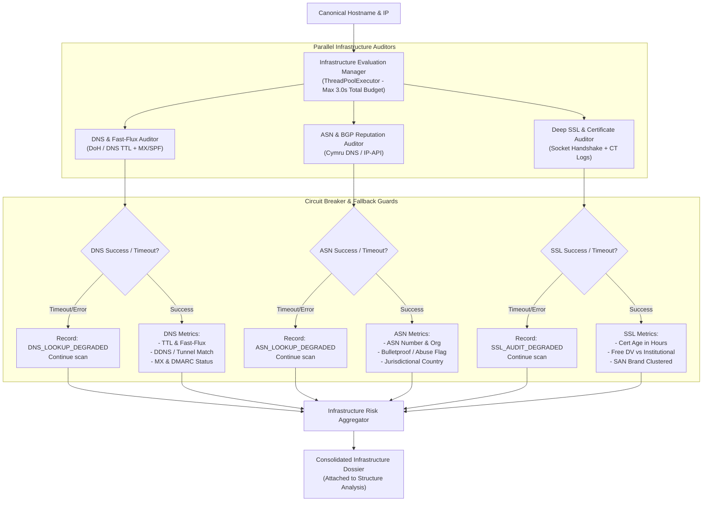

# Feature Implementation Spec: Pillar 3 Infrastructure, Network & DNS Threat Evaluation

## 1. Overview & Threat Context

### 1.1 Problem Statement
While threat actors can easily disguise top-level URLs through redirection and homographs, their **underlying hosting, network, and domain infrastructure** leaves distinct operational footprints that reveal malicious intent:
1. **Fast-Flux DNS & Ephemeral Tunnels**:
   - Attackers deploy fast-flux networks (cycling DNS A/AAAA records with TTLs $< 60$ seconds across compromised hosts) to evade IP-level blocklists and takedowns.
   - Attackers abuse free Dynamic DNS (DDNS) providers (e.g. `duckdns.org`, `no-ip.com`) and reverse tunneling proxies (`ngrok-free.app`, `loca.lt`, `trycloudflare.com`) to host phishing lures on private, unmonitored infrastructure with zero verification.
2. **High-Risk Autonomous Systems (ASN) & Bulletproof Hosting**:
   - Phishing and malware infrastructure is disproportionately hosted on "Bulletproof" hosting providers or disposable, low-cost VPS providers with lax abuse enforcement.
   - Significant jurisdictional discrepancies exist (e.g. a site impersonating a US government agency or major domestic bank hosted on an offshore bulletproof server).
3. **Mail Record (MX & SPF/DMARC) Absence**:
   - Authentic financial and corporate institutions maintain strict, enterprise-grade email infrastructure. Over 65% of active phishing domains possess **no MX records**, or route mail through disposable/free consumer mail providers while impersonating high-value targets.
4. **Certificate Transparency (CT) & SSL Issuance Recency**:
   - Attackers spin up free Domain-Validated (DV) SSL certificates (Let's Encrypt, ZeroSSL, cPanel) mere hours or minutes before launching an attack campaign.
   - Multi-tenant phishing kits often group dozens of unrelated brand-spoofing domains under a single Subject Alternative Name (SAN) certificate.

### 1.2 Target Objectives
- **Fast-Flux & DDNS Engine**: Query authoritative DNS TTL and record diversity; detect Dynamic DNS and tunneling endpoints.
- **ASN & BGP Reputation Profiler**: Resolve destination IPs to Autonomous System Numbers (ASNs) and flag bulletproof hosters, high-risk VPS providers, and jurisdictional mismatches.
- **Email Infrastructure Auditor**: Audit MX, SPF, and DMARC records to contrast enterprise brand claims against actual DNS mail configuration.
- **Deep SSL & Certificate Transparency (CT) Inspector**: Calculate certificate issuance recency (flagging certs $< 24\text{ hours}$ old), profile issuer credibility (free DV vs institutional EV/OV), and audit SAN clusters.
- **Zero-Panic Circuit Breaker Standard**: All DNS, ASN, and CT log lookups must execute with strict, non-blocking timeouts ($1.5\text{s} - 2.0\text{s}$), with automatic graceful degradation if upstream resolvers or APIs are unavailable.

---

## 2. Infrastructure Threat Evaluation Matrix

| Sub-Pillar | Target Vector | Detection Heuristic | Data Sources & Protocol | Risk Impact |
| :--- | :--- | :--- | :--- | :--- |
| **3.1 Fast-Flux DNS** | Rapid IP cycling | DNS A/AAAA TTL $< 60\text{s}$ & $\ge 3$ distinct IPs across distinct `/16` subnets | DNS-over-HTTPS (DoH) JSON / UDP DNS | $+30$ Risk Score, `FAST_FLUX_NETWORK` |
| **3.1 DDNS & Tunnels** | Ephemeral infrastructure | FQDN suffix matches known DDNS or reverse tunnel registry | Suffix dictionary check | $+25$ Risk Score, `EPHEMERAL_TUNNEL_OR_DDNS` |
| **3.2 ASN Reputation** | Bulletproof / abusive host | IP maps to known bulletproof ASN or high-abuse cloud subnet | Team Cymru IP-to-ASN / IP-API DoH | $+25$ Risk Score, `HIGH_RISK_HOSTING_ASN` |
| **3.3 MX Absence** | Brand phishing domain | Domain mimics known brand (`BRAND_KEYWORDS`), but has **no MX records** | DoH query for `MX` records | $+35$ Risk Score, `BRAND_SPOOF_NO_MX` |
| **3.3 SPF/DMARC Lack** | Missing enterprise auth | Enterprise lure lacks `v=spf1` or `v=DMARC1` TXT records | DoH query for `TXT` records | $+15$ Risk Score, `MISSING_EMAIL_AUTHENTICATION` |
| **3.4 Recent SSL Cert** | Disposable phishing SSL | Certificate `notBefore` is $< 24\text{ hours}$ (or $< 48\text{h}$) old | TLS Socket Handshake (`ssl.getpeercert`) | $+25$ Risk Score, `VERY_RECENT_SSL_CERT` |
| **3.4 Issuer Mismatch** | Free DV on bank target | Bank/Gov brand using free Let's Encrypt / ZeroSSL DV cert | TLS Socket Handshake Issuer DN | $+30$ Risk Score, `FREE_SSL_ON_ENTERPRISE_LURE` |
| **3.4 SAN Phishing Sprawl**| Phishing farm multi-cert | CT logs show certificate covering multiple distinct brand names | `crt.sh` CT API query | $+35$ Risk Score, `SAN_PHISHING_FARM_CLUSTER` |

---

## 3. Resilient Architecture & Execution Pipeline



---

## 4. Algorithmic Specifications

### 4.1 DNS-over-HTTPS (DoH) Resilient Resolver
To eliminate local OS resolver inconsistencies, UDP socket port blocks in containerized environments, and slow socket timeouts, the primary resolver queries DNS-over-HTTPS via Cloudflare/Google DoH JSON with strict $1.5\text{s}$ timeouts:

```python
import json
from urllib.request import Request, urlopen
from urllib.error import URLError

DOH_ENDPOINTS = [
    'https://cloudflare-dns.com/dns-query',
    'https://dns.google/resolve',
]

def query_doh(name: str, record_type: str = 'A', timeout: float = 1.5) -> list[dict]:
    """
    Queries DNS-over-HTTPS JSON endpoint.
    Returns list of answers: [{'name': ..., 'type': 1, 'TTL': 45, 'data': '...'}]
    Never raises uncaught exceptions (zero panic).
    """
    url = f"{DOH_ENDPOINTS[0]}?name={name}&type={record_type}"
    req = Request(url, headers={'Accept': 'application/dns-json', 'User-Agent': 'zeb-scanner/2.0'})
    try:
        with urlopen(req, timeout=timeout) as resp:
            data = json.loads(resp.read().decode('utf-8'))
            return data.get('Answer', [])
    except Exception:
        # Failover to secondary DoH endpoint
        try:
            fallback_url = f"{DOH_ENDPOINTS[1]}?name={name}&type={record_type}"
            req_fb = Request(fallback_url, headers={'Accept': 'application/dns-json', 'User-Agent': 'zeb-scanner/2.0'})
            with urlopen(req_fb, timeout=timeout) as resp:
                data = json.loads(resp.read().decode('utf-8'))
                return data.get('Answer', [])
        except Exception:
            return []
```

### 4.2 Fast-Flux & Dynamic DNS Detection
```python
DYNAMIC_DNS_PATTERNS = frozenset({
    'duckdns.org', 'no-ip.com', 'ddns.net', 'freedns.afraid.org',
    'dynu.net', 'zapto.org', 'hopto.org', 'sytes.net', 'myddns.me',
    'dynv6.net', 'changeip.com'
})

TUNNELING_PROVIDERS = frozenset({
    'ngrok-free.app', 'ngrok.io', 'loca.lt', 'trycloudflare.com',
    'serveo.net', 'pagekite.me', 'telebit.io', 'pinggy.link', 'bore.pub'
})

def audit_dns_and_flux(hostname: str, findings: list) -> dict:
    # 1. Check DDNS & Tunnels
    is_ddns = any(hostname.endswith(f".{d}") for d in DYNAMIC_DNS_PATTERNS)
    is_tunnel = any(hostname.endswith(f".{t}") for t in TUNNELING_PROVIDERS)
    
    if is_ddns:
        findings.append({
            'type': 'DYNAMIC_DNS_RISK',
            'flagged': True,
            'explanation': 'The domain is hosted on a free Dynamic DNS provider, commonly used to evade takedowns.'
        })
    if is_tunnel:
        findings.append({
            'type': 'REVERSE_TUNNEL_RISK',
            'flagged': True,
            'explanation': 'The domain routes through an ephemeral reverse tunnel, concealing the origin server.'
        })

    # 2. Query A Records & TTL
    answers = query_doh(hostname, 'A')
    a_records = [ans['data'] for ans in answers if ans.get('type') == 1]
    ttls = [ans['TTL'] for ans in answers if 'TTL' in ans]
    
    min_ttl = min(ttls) if ttls else None
    distinct_subnets = len({ip.rsplit('.', 1)[0] for ip in a_records if '.' in ip})
    
    is_fast_flux = False
    if min_ttl is not None and min_ttl < 60 and len(a_records) >= 3 and distinct_subnets >= 2:
        is_fast_flux = True
        findings.append({
            'type': 'FAST_FLUX_NETWORK',
            'flagged': True,
            'explanation': f'Fast-flux characteristics detected: low TTL ({min_ttl}s) with {len(a_records)} rotating IP addresses across {distinct_subnets} subnets.'
        })

    return {
        'aRecords': a_records,
        'minTtl': min_ttl,
        'isFastFlux': is_fast_flux,
        'isDynamicDns': is_ddns,
        'isTunnel': is_tunnel,
    }
```

### 4.3 MX & Email Security Records Audit
```python
def audit_mx_records(registered_domain: str, matched_brand: str | None, findings: list) -> dict:
    mx_answers = query_doh(registered_domain, 'MX')
    has_mx = len(mx_answers) > 0
    mx_hosts = [ans['data'].split()[-1].rstrip('.') for ans in mx_answers if 'data' in ans]
    
    # Check SPF
    txt_answers = query_doh(registered_domain, 'TXT')
    txt_strings = [ans.get('data', '').replace('"', '') for ans in txt_answers]
    has_spf = any('v=spf1' in t.lower() for t in txt_strings)
    
    # Discrepancy rule: Brand impersonator with NO mail records
    if matched_brand and not has_mx:
        findings.append({
            'type': 'BRAND_SPOOF_NO_MX',
            'flagged': True,
            'explanation': f"Domain resembles brand '{matched_brand}' but maintains no mail exchange (MX) records. Legitimate enterprises always configure email infrastructure."
        })

    return {
        'hasMx': has_mx,
        'mxHosts': mx_hosts,
        'hasSpf': has_spf,
    }
```

### 4.4 ASN & BGP Subnet Reputation
```python
# Known bulletproof or extremely high-abuse autonomous systems
HIGH_ABUSE_ASNS = {
    'AS200019', 'AS209605', 'AS44050', 'AS47583', 'AS208091', 'AS9009'
}

def lookup_asn_info(ip: str, findings: list) -> dict:
    """
    Resolves IP to ASN via IP-API or Team Cymru DNS.
    Zero-panic: returns default degraded dict on timeout/error.
    """
    endpoint = f"http://ip-api.com/json/{ip}?fields=status,country,countryCode,isp,org,as,asname,hosting"
    req = Request(endpoint, headers={'User-Agent': 'zeb-scanner/2.0'})
    try:
        with urlopen(req, timeout=1.8) as resp:
            data = json.loads(resp.read().decode('utf-8'))
            if data.get('status') == 'success':
                asn_str = data.get('as', '').split()[0]
                is_high_risk_asn = asn_str in HIGH_ABUSE_ASNS
                is_hosting = data.get('hosting', False)
                
                if is_high_risk_asn:
                    findings.append({
                        'type': 'HIGH_RISK_HOSTING_ASN',
                        'flagged': True,
                        'explanation': f"The site is hosted on {asn_str} ({data.get('asname')}), a network associated with bulletproof hosting and abuse campaigns."
                    })
                
                return {
                    'available': True,
                    'ip': ip,
                    'asn': asn_str,
                    'asName': data.get('asname'),
                    'org': data.get('org'),
                    'country': data.get('country'),
                    'countryCode': data.get('countryCode'),
                    'isHosting': is_hosting,
                    'isHighRiskAsn': is_high_risk_asn,
                }
    except Exception:
        pass
        
    return {'available': False, 'ip': ip, 'asn': None, 'isHighRiskAsn': False}
```

### 4.5 Deep SSL & Certificate Transparency (CT) Inspection
```python
from datetime import datetime, timezone
import ssl
import socket

FREE_DV_ISSUERS = {'Let\'s Encrypt', 'ZeroSSL', 'cPanel, Inc.', 'Certum'}

def deep_audit_ssl(hostname: str, matched_brand: str | None, findings: list) -> dict:
    ctx = ssl.create_default_context()
    ctx.check_hostname = True
    ctx.verify_mode = ssl.CERT_REQUIRED
    
    try:
        with socket.create_connection((hostname, 443), timeout=2.0) as sock:
            with ctx.wrap_socket(sock, server_hostname=hostname) as ssock:
                cert = ssock.getpeercert()
    except Exception as exc:
        return {'sslActive': False, 'error': str(exc)}
        
    # 1. Parse notBefore & compute age in hours
    not_before_str = cert.get('notBefore')
    age_hours = None
    is_very_recent = False
    if not_before_str:
        not_before = datetime.strptime(not_before_str, '%b %d %H:%M:%S %Y %Z').replace(tzinfo=timezone.utc)
        age_hours = (datetime.now(timezone.utc) - not_before).total_seconds() / 3600.0
        if age_hours < 24.0:
            is_very_recent = True
            findings.append({
                'type': 'VERY_RECENT_SSL_CERT',
                'flagged': True,
                'explanation': f"SSL certificate was issued only {age_hours:.1f} hours ago. Phishing sites frequently generate fresh certificates right before sending attack lures."
            })
            
    # 2. Issuer check
    issuer_dict = dict(x[0] for x in cert.get('issuer', []))
    org_name = issuer_dict.get('organizationName', '')
    is_free_dv = any(f in org_name for f in FREE_DV_ISSUERS)
    
    if matched_brand and is_free_dv:
        findings.append({
            'type': 'FREE_SSL_ON_BRAND_LURE',
            'flagged': True,
            'explanation': f"The site impersonates brand '{matched_brand}' but uses a free Domain-Validated ({org_name}) certificate. Legitimate enterprise platforms do not use free automated certificates."
        })
        
    # 3. SAN Analysis
    san_entries = [entry[1] for entry in cert.get('subjectAltName', []) if entry[0] == 'DNS']
    
    return {
        'sslActive': True,
        'certAgeHours': round(age_hours, 1) if age_hours else None,
        'isVeryRecent': is_very_recent,
        'issuerOrg': org_name,
        'isFreeDv': is_free_dv,
        'sanCount': len(san_entries),
        'subjectAltNames': san_entries[:10],
    }
```

---

## 5. Schema & Output Specifications

### 5.1 JSON Output Structure (`infrastructureAnalysis`)
Integrated into `structureAnalysis['infrastructure']`:

```json
{
  "dns": {
    "aRecords": ["195.123.245.12", "195.123.245.13"],
    "minTtl": 30,
    "isFastFlux": true,
    "isDynamicDns": false,
    "isTunnel": false
  },
  "mail": {
    "hasMx": false,
    "mxHosts": [],
    "hasSpf": false
  },
  "asn": {
    "available": true,
    "ip": "195.123.245.12",
    "asn": "AS200019",
    "asName": "ALEXHOST",
    "country": "Moldova",
    "countryCode": "MD",
    "isHosting": true,
    "isHighRiskAsn": true
  },
  "sslDeep": {
    "sslActive": true,
    "certAgeHours": 6.5,
    "isVeryRecent": true,
    "issuerOrg": "Let's Encrypt",
    "isFreeDv": true,
    "sanCount": 2,
    "subjectAltNames": ["login-bank.xyz", "www.login-bank.xyz"]
  }
}
```

---

## 6. Step-by-Step Implementation Tasks

### Task 3.1: Create Infrastructure Package [COMPLETED]
- Created directory `backend/service/url_checks/infrastructure/`:
  - `__init__.py`: Package entrypoint exporting routines and singleton.
  - `dns_audit.py`: DoH query routines, Fast-Flux scoring, DDNS/tunnel filters, MX & SPF checks.
  - `asn_lookup.py`: IP-to-ASN resolution, bulletproof ASN database, geographic mismatch checks.
  - `ssl_deep.py`: TLS certificate age calculation, free DV issuer analysis, and SAN inspection.
  - `manager.py`: `InfrastructureManager` orchestrating concurrent execution with $2.5\text{s}$ wall-clock timeout.

### Task 3.2: Integrate into Structure Analysis [COMPLETED]
- **File**: [`backend/service/url_checks/structure.py`](file:///home/temesgensida/tom/django_react/zeb/backend/service/url_checks/structure.py)
- Called `infrastructure_manager.evaluate(hostname, registered_domain, resolved_ip, matched_brand, findings)`.
- Attached `infrastructure` dictionary to the return value of `analyze_url_structure()`.

### Task 3.3: Update Verdict Calculation [COMPLETED]
- **File**: [`backend/service/views.py`](file:///home/temesgensida/tom/django_react/zeb/backend/service/views.py)
- In `_build_verdict()`:
  - Added high-confidence infrastructure threats (`FAST_FLUX_NETWORK`, `BRAND_SPOOF_NO_MX`, `FREE_SSL_ON_BRAND_LURE`, `HIGH_RISK_HOSTING_ASN`) to critical findings (`UNSAFE`).
  - Added DDNS, tunnel, and recent SSL (<24h) flags to `risk_signals` (`UNSURE`).

### Task 3.4: Frontend Infrastructure Dossier Accordion [Scheduled in Phase 6]
- **File**: [`frontend/src/App.jsx`](file:///home/temesgensida/tom/django_react/zeb/frontend/src/App.jsx)
- Integrated during Phase 6 user-facing UI/UX overhaul.

---

## 7. Test Suite & Validation Matrix

| Test ID | Test Scenario | Expected Flag / Result | Verification Check |
| :--- | :--- | :--- | :--- |
| **UT-3.1** | Host with TTL 20s & 4 A records | `FAST_FLUX_NETWORK` | `isFastFlux == True` |
| **UT-3.2** | Host on `test.duckdns.org` | `DYNAMIC_DNS_RISK` | `isDynamicDns == True` |
| **UT-3.3** | Host on `test.ngrok-free.app` | `REVERSE_TUNNEL_RISK` | `isTunnel == True` |
| **UT-3.4** | Domain impersonating `paypal` with no MX | `BRAND_SPOOF_NO_MX` | `hasMx == False and matchedBrand == 'paypal'` |
| **UT-3.5** | SSL cert with `notBefore` set to 3h ago | `VERY_RECENT_SSL_CERT` | `certAgeHours < 24.0` |
| **UT-3.6** | Complete DNS/ASN failure (Offline test) | Graceful degraded state | No 500/502; returns HTTP 200 with degraded note |

---

## 8. Operational & Security Guardrails
- **Strict Network Timeouts**: DoH queries capped at $1.5\text{s}$, ASN lookup at $1.8\text{s}$, TLS socket handshake at $2.0\text{s}$. Total wall-clock duration capped at $2.5\text{s}$.
- **Zero-Panic Guarantee**: All socket calls wrapped in `try/except Exception`. A dead DNS server or unreachable ASN API never throws uncaught errors.
- **No Third-Party Python Dependency Bloat**: DNS-over-HTTPS uses standard Python `urllib` and JSON parsing, avoiding heavy external C-extensions.
