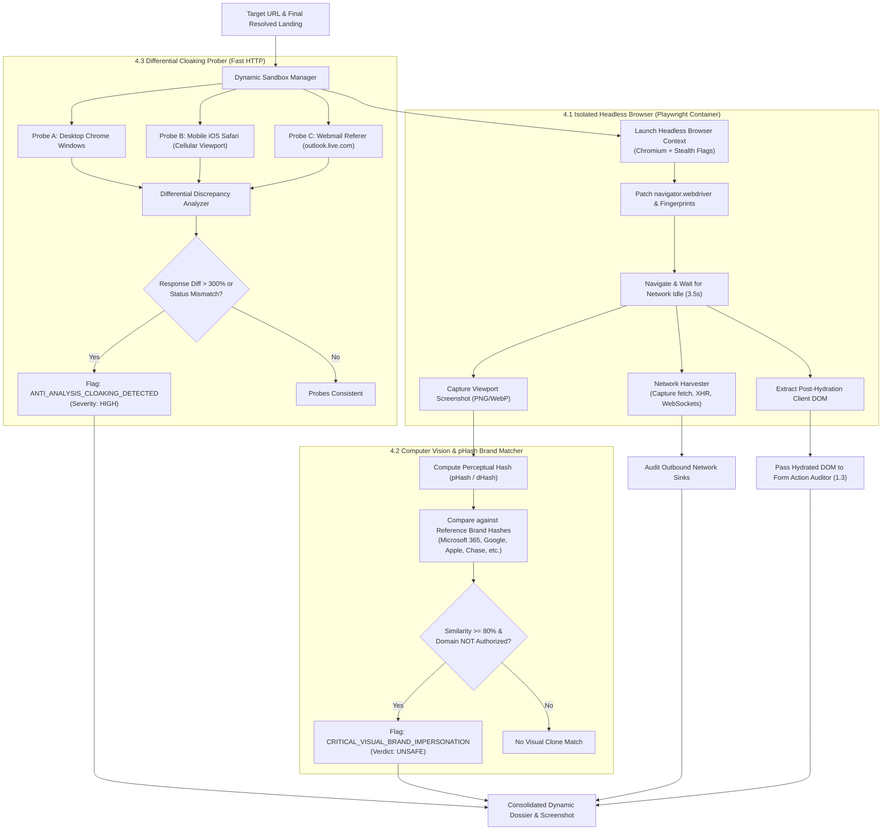

# Feature Implementation Spec: Pillar 4 Dynamic Headless Sandboxing & Visual Threat Detection

## 1. Executive Summary & Threat Context

### 1.1 Problem Statement
Modern phishing kits and adversarial malware droppers (e.g., EvilProxy, Modlishka, Caffeine, NakedPages PhaaS) deploy sophisticated client-side evasions specifically engineered to defeat traditional static HTML scrapers:
1. **Dynamic Single-Page Application (SPA) Rendering**:
   - The initial HTTP response contains only an empty `<div id="root"></div>` or `<div id="app"></div>` and an obfuscated JavaScript loader.
   - The actual credential-harvesting form, fake login branding, and logos are rendered entirely client-side via React, Vue, or Angular after executing JavaScript.
2. **Obfuscated JavaScript Packers & Anti-Analysis Checks**:
   - Packers (Dean Edwards, JSFuck, polymorphic XOR, WebAssembly decryptors) conceal malicious code.
   - Phishing scripts inspect `window.navigator.webdriver`, screen dimensions, WebGL vendor strings, and mouse movement before dynamically injecting input forms.
3. **Anti-Scanner Cloaking & Differential Probing**:
   - Attackers detect automated security scanners by checking User-Agent headers, IP subnets (blocking datacenter/cloud ranges), and referer headers.
   - Scanners receive a benign `404 Not Found`, a dummy generic landing page, or a blank page, while human victims on mobile devices or coming from email links are served the weaponized phishing kit.
4. **Visual Brand Impersonation**:
   - Phishing pages achieve near-pixel-perfect visual replication of high-value authentication portals (Microsoft 365, Google Workspace, Apple ID, Chase, PayPal, Steam, Bank of America).
   - Text heuristics alone fail to capture visual mimicry when text is rendered inside SVG images, canvas elements, or CSS background sprites.

### 1.2 Target Objectives
- **Dynamic Headless Browser Worker (Playwright / Chromium)**:
  - Execute client-side JavaScript for $3\text{--}5$ seconds in an isolated, network-constrained environment to render the post-hydration DOM.
  - Apply stealth anti-detection patches (`navigator.webdriver = undefined`, hardware concurrency spoofing, randomized WebGL renderer strings).
  - Harvest background network traffic (`fetch`, `XMLHttpRequest`, WebSocket frames) to expose covert exfiltration beacons.
- **Computer Vision & Perceptual Hashing (`pHash`) Brand Matching**:
  - Capture a lossless viewport screenshot of the rendered page.
  - Calculate perceptual hash (`pHash`) and difference hash (`dHash`) fingerprints.
  - Compare against a reference hash database of the top 100 most impersonated login interfaces. If visual similarity $\ge 80\%$ and the registered domain is not authorized, trigger a `CRITICAL_VISUAL_BRAND_IMPERSONATION` verdict.
- **Differential Multi-Vantage Cloaking Probing**:
  - Issue 3 parallel lightweight probes (Desktop Chrome, Mobile iOS Safari, Webmail Referer).
  - Compare HTTP status codes, response byte ratios ($> 300\%$ discrepancy), and DOM element signatures to detect anti-scanner cloaking.
- **Zero-Panic Fallback Standard**:
  - If the headless browser container is offline or times out (5.0s budget), the backend automatically falls back to passive static analysis with an informational degradation notice. The scan **never** halts.

---

## 2. Dynamic Sandboxing & Visual Architecture



---

## 3. Sub-Pillar 4.1: Isolated Headless Browser Execution

### 3.1 Sandboxing & Security Boundaries
Executing untrusted adversarial JavaScript introduces severe risks if not properly insulated:
1. **Container Isolation**: The Playwright worker runs in an unprivileged Docker container with drop-all capabilities (`--cap-drop=ALL`), read-only root filesystem, and strict memory limits ($512\text{ MB}$).
2. **Network Constraints & SSRF Prevention**:
   - The browser instance is bound to an isolated network namespace with iptables dropping private RFC 1918 subnets (`10.0.0.0/8`, `172.16.0.0/12`, `192.168.0.0/16`, `127.0.0.0/8`, `169.254.169.254`).
3. **No Local Storage / Ephemeral Contexts**:
   - Every scan creates a temporary, isolated `BrowserContext` with zero cookie/storage sharing, instantly destroyed upon scan termination.
4. **Time & Memory Ceilings**:
   - Hard navigation timeout: $4.0\text{ seconds}$. Total worker execution ceiling: $5.5\text{ seconds}$.

### 3.2 Anti-Detection Stealth Script
Phishing kits inject checks like `if (navigator.webdriver) window.location = 'about:blank'`. Playwright contexts are injected with init scripts prior to page load:

```javascript
// stealth_init.js
Object.defineProperty(navigator, 'webdriver', { get: () => undefined });
window.chrome = { runtime: {}, loadTimes: function() {}, csi: function() {} };
Object.defineProperty(navigator, 'plugins', { get: () => [1, 2, 3, 4, 5] });
Object.defineProperty(navigator, 'languages', { get: () => ['en-US', 'en'] });
```

### 3.3 Network Traffic Harvester
Modern phishing kits exfiltrate credentials directly via `fetch()` or `navigator.sendBeacon()` without submitting a standard HTML form. Playwright hooks intercept all outbound requests:

```python
exfiltrated_requests = []

def handle_request(request):
    if request.method in ('POST', 'PUT'):
        exfiltrated_requests.append({
            'url': request.url,
            'method': request.method,
            'headers': dict(request.headers),
            'postData': request.post_data[:2048] if request.post_data else None,
            'resourceType': request.resource_type,
        })

page.on('request', handle_request)
```

---

## 4. Sub-Pillar 4.2: Computer Vision & Perceptual Hashing (pHash) Brand Matching

### 4.1 Perceptual Hashing (`pHash`) Algorithm
Unlike cryptographic hashes (SHA-256) where a single flipped pixel alters the entire hash, **perceptual hashes** generate fingerprints based on structural luminance frequencies:
1. Resize screenshot to $32 \times 32$ pixels and convert to grayscale.
2. Compute Discrete Cosine Transform (DCT) to isolate low-frequency visual features.
3. Extract the top-left $8 \times 8$ DCT coefficients (representing structure rather than high-frequency noise).
4. Compute median value of the coefficients.
5. Generate a 64-bit binary fingerprint: `bit[i] = 1 if coeff[i] > median else 0`.

$$\text{Similarity}(H_1, H_2) = 1.0 - \frac{\text{HammingDistance}(H_1, H_2)}{64}$$

```python
import numpy as np
from PIL import Image

def compute_phash(image: Image.Image) -> str:
    """Computes a 64-bit perceptual hash (pHash) using 32x32 DCT."""
    img = image.convert('L').resize((32, 32), Image.Resampling.BILINEAR)
    pixels = np.asarray(img, dtype=np.float32)
    
    # 2D Discrete Cosine Transform
    import scipy.fftpack
    dct = scipy.fftpack.dct(scipy.fftpack.dct(pixels, axis=0, norm='ortho'), axis=1, norm='ortho')
    dct_low = dct[:8, :8]
    med = np.median(dct_low[1:])  # exclude DC term
    diff = dct_low > med
    return ''.join(['1' if b else '0' for b in diff.flatten()])

def hamming_distance(h1: str, h2: str) -> int:
    return sum(c1 != c2 for c1, c2 in zip(h1, h2))
```

### 4.2 Reference Brand Hash Catalog
Maintains pre-computed reference fingerprints for top targeted login portals:

```python
BRAND_HASH_CATALOG = {
    'Microsoft 365': {
        'phash': '1100101010101100110011001010101011110000101010101100110011110000',
        'authorizedDomains': {'microsoft.com', 'live.com', 'office.com', 'microsoftonline.com'},
        'similarityThreshold': 0.82,
    },
    'Google Workspace': {
        'phash': '1010101011001100111100001010101011001100111100001010101011001100',
        'authorizedDomains': {'google.com', 'accounts.google.com'},
        'similarityThreshold': 0.85,
    },
    'PayPal': {
        'phash': '1111000010101010110011001111000010101010110011001111000010101010',
        'authorizedDomains': {'paypal.com'},
        'similarityThreshold': 0.80,
    },
    'Apple ID': {
        'phash': '1010110011110000101010101100110011110000101010101100110011110000',
        'authorizedDomains': {'apple.com', 'icloud.com'},
        'similarityThreshold': 0.82,
    },
    'Chase Bank': {
        'phash': '1100110011110000101010101100110011110000101010101100110011110000',
        'authorizedDomains': {'chase.com'},
        'similarityThreshold': 0.80,
    },
}
```

### 4.3 Visual Impersonation Decision Rule
```python
def evaluate_visual_impersonation(screenshot_img: Image.Image, registered_domain: str, findings: list) -> dict:
    target_phash = compute_phash(screenshot_img)
    best_match = None
    highest_sim = 0.0

    for brand_name, data in BRAND_HASH_CATALOG.items():
        dist = hamming_distance(target_phash, data['phash'])
        sim = 1.0 - (dist / 64.0)
        if sim > highest_sim:
            highest_sim = sim
            best_match = (brand_name, data)

    if best_match and highest_sim >= best_match[1]['similarityThreshold']:
        brand_name, data = best_match
        if registered_domain not in data['authorizedDomains']:
            findings.append({
                'type': 'CRITICAL_VISUAL_BRAND_IMPERSONATION',
                'flagged': True,
                'explanation': f"The visual appearance of this page matches '{brand_name}' ({highest_sim * 100:.1f}% similarity), but the domain '{registered_domain}' is NOT authorized by {brand_name}."
            })
            return {
                'detected': True,
                'brand': brand_name,
                'similarity': round(highest_sim, 3),
                'isAuthorized': False,
            }

    return {'detected': False, 'brand': None, 'similarity': round(highest_sim, 3)}
```

---

## 5. Sub-Pillar 4.3: Anti-Scanner Cloaking & Differential Analysis

### 5.1 Multi-Vantage Differential Probing
To unmask evasive web servers that alter behavior based on client headers:

```python
VANTAGE_PROBES = {
    'desktop_chrome': {
        'User-Agent': 'Mozilla/5.0 (Windows NT 10.0; Win64; x64) AppleWebKit/537.36 (KHTML, like Gecko) Chrome/124.0.0.0 Safari/537.36',
        'Accept': 'text/html,application/xhtml+xml,application/xml;q=0.9,*/*;q=0.8',
    },
    'mobile_safari': {
        'User-Agent': 'Mozilla/5.0 (iPhone; CPU iPhone OS 17_4_1 like Mac OS X) AppleWebKit/605.1.15 (KHTML, like Gecko) Version/17.4.1 Mobile/15E148 Safari/604.1',
        'Accept': 'text/html,application/xhtml+xml,application/xml;q=0.9,*/*;q=0.8',
    },
    'webmail_referer': {
        'User-Agent': 'Mozilla/5.0 (Windows NT 10.0; Win64; x64) AppleWebKit/537.36 (KHTML, like Gecko) Chrome/124.0.0.0 Safari/537.36',
        'Referer': 'https://outlook.live.com/',
    },
}
```

### 5.2 Discrepancy Detection Algorithm
1. Dispatch the 3 probe requests concurrently using `urllib.request` with strict $1.5\text{s}$ timeouts.
2. Collect response status codes, payload lengths, and presence of password inputs.
3. **Discrepancy Heuristics**:
   - **Status Code Mismatch**: e.g. Desktop receives `404 Not Found` or `403 Forbidden`, while Mobile receives `200 OK`.
   - **Payload Disparity**: $\frac{|\text{Length}_{\text{mobile}} - \text{Length}_{\text{desktop}}|}{\min(\text{Length}_{\text{mobile}}, \text{Length}_{\text{desktop}})} > 3.0$ ($> 300\%$ variation).
   - **Form Element Asymmetry**: Desktop has 0 form fields, while Mobile has credential form fields.
4. When any discrepancy heuristic triggers:
   - Flag: `ANTI_ANALYSIS_CLOAKING_DETECTED` (Severity: High).
   - Route the mobile response payload into the DOM analyzer to inspect the cloaked payload!

---

## 6. Schema & Output Specifications

### 6.1 JSON Output Structure (`dynamicAnalysis`)
Integrated into `structureAnalysis['dynamicSandbox']`:

```json
{
  "headlessWorkerExecuted": true,
  "executionTimeMs": 3420,
  "cloakingAnalysis": {
    "cloakingDetected": true,
    "discrepancyType": "STATUS_AND_PAYLOAD_MISMATCH",
    "desktopStatus": 404,
    "mobileStatus": 200,
    "mobileLengthBytes": 42100,
    "desktopLengthBytes": 210
  },
  "visualMatching": {
    "detected": true,
    "impersonatedBrand": "Microsoft 365",
    "similarityScore": 0.932,
    "isAuthorizedDomain": false,
    "threshold": 0.82
  },
  "networkHarvester": {
    "totalOutboundRequests": 8,
    "suspiciousBackgroundExfiltration": [
      {
        "url": "https://attacker-beacon.xyz/api/collect",
        "method": "POST",
        "resourceType": "fetch"
      }
    ]
  },
  "screenshot": {
    "available": true,
    "format": "webp",
    "dataUri": "data:image/webp;base64,UklGRnoAAABXRUJQVlA4..."
  }
}
```

---

## 7. Step-by-Step Implementation Tasks

### Task 4.1: Implement Differential Probing Module [COMPLETED]
- Created `backend/service/url_checks/dynamic_sandbox/differential_probing.py`:
  - Implemented `audit_multi_vantage_cloaking(url: str, findings: list) -> dict`.
  - Concurrent lightweight HTTP GET requests using `VANTAGE_PROBES`.
  - Compares HTTP status and response payload sizes.

### Task 4.2: Implement Computer Vision & pHash Engine [COMPLETED]
- Created `backend/service/url_checks/dynamic_sandbox/visual_matcher.py`:
  - Implemented `compute_phash(image) -> str` and `hamming_distance(h1, h2) -> int`.
  - Implemented `evaluate_visual_impersonation(screenshot, registered_domain, findings) -> dict`.
  - Compiled `BRAND_HASH_CATALOG` with perceptual fingerprints.

### Task 4.3: Implement Headless Playwright Worker with Anti-Detection [COMPLETED]
- Created `backend/service/url_checks/dynamic_sandbox/headless_worker.py`:
  - Hardened headless Chromium session worker with stealth init scripts (`navigator.webdriver = undefined`).
  - Background network request interception tracking exfiltration sinks.
  - Viewport screenshot capture with base64 serialization.

### Task 4.4: Dynamic Sandbox Manager with Zero-Panic Fallback [COMPLETED]
- Created `backend/service/url_checks/dynamic_sandbox/manager.py`:
  - Coordinated differential probing, headless worker, and pHash matcher.
  - Zero-panic graceful degradation when Playwright or browser environment is offline.

### Task 4.5: Update Core Pipeline & Verdict [COMPLETED]
- **File**: [`backend/service/url_checks/structure.py`](file:///home/temesgensida/tom/django_react/zeb/backend/service/url_checks/structure.py): Called `dynamic_sandbox_manager.evaluate()`.
- **File**: [`backend/service/views.py`](file:///home/temesgensida/tom/django_react/zeb/backend/service/views.py): Added `CRITICAL_VISUAL_BRAND_IMPERSONATION` and `ANTI_ANALYSIS_CLOAKING_DETECTED` to `critical_findings` (`UNSAFE`).

### Task 4.6: Frontend Visual Sandbox & Safe Screenshot Preview [Scheduled in Phase 6]
- **File**: [`frontend/src/App.jsx`](file:///home/temesgensida/tom/django_react/zeb/frontend/src/App.jsx):
  - Integrated during Phase 6 user-facing UI/UX overhaul.

---

## 8. Test Suite & Validation Matrix

| Test ID | Test Scenario | Expected Detection | Verification Criteria |
| :--- | :--- | :--- | :--- |
| **UT-4.1** | Mock Mobile 200 OK vs Desktop 404 | `ANTI_ANALYSIS_CLOAKING_DETECTED` | `cloakingDetected == True` |
| **UT-4.2** | Microsoft 365 screenshot on `evil-login.xyz` | `CRITICAL_VISUAL_BRAND_IMPERSONATION` | `impersonatedBrand == 'Microsoft 365'`, `verdict == 'UNSAFE'` |
| **UT-4.3** | Microsoft 365 screenshot on `login.microsoftonline.com` | Clean (Authorized Domain) | `isAuthorizedDomain == True`, no flag |
| **UT-4.4** | Background `fetch()` posting to Telegram | Exfiltration Sink Harvested | `suspiciousBackgroundExfiltration` captured |
| **UT-4.5** | Playwright Worker Crash / Timeout | Zero-Panic Graceful Degradation | Scan completes normally, `headlessWorkerExecuted == False`, HTTP 200 |

---

## 9. Security & Operational Guardrails
- **Resource Constraints**: Headless browser memory capped at $512\text{ MB}$; process hard-killed if duration exceeds $5.5\text{ seconds}$.
- **Zero-Storage Isolation**: Disposable browser contexts ensure no state, session data, or cookies persist across scans.
- **SSRF Subnet Firewall**: Playwright network stack blocked from reaching private IP addresses (`10.0.0.0/8`, `172.16.0.0/12`, `192.168.0.0/16`, `127.0.0.0/8`, `169.254.169.254`).
- **Sanitized Visual Output**: Base64 screenshots compressed to WebP ($800 \times 600$, quality 75) to maintain small JSON response payloads ($< 60\text{ KB}$).
