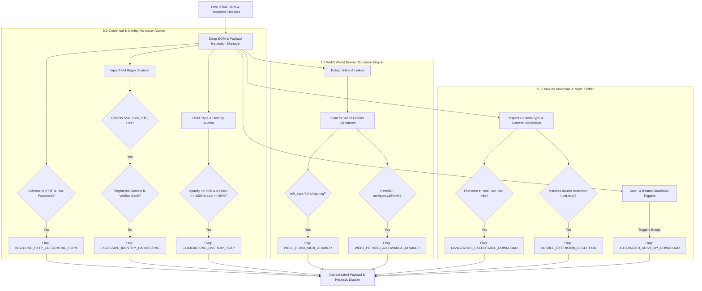

# Feature Implementation Spec: Pillar 5 Deep DOM, Form Action & Payload Inspection

## 1. Executive Summary & Threat Context

### 1.1 Problem Statement
Modern cyber threats extend far beyond simple static phishing templates. Attackers employ sophisticated behavioral payload techniques embedded directly within web pages:
1. **Aggressive Identity & Multi-Factor Credential Harvesting**:
   - Beyond simple username/password fields, phishing kits systematically harvest high-value identity artifacts to defeat Know-Your-Customer (KYC) protections, step-up authentication, and multi-factor authentication (MFA):
     - Social Security Numbers (SSN), National Identity Numbers (SIN, NIN, Tax ID).
     - Full Credit Card dossiers including CVV, expiration dates, and cardholder addresses.
     - Security challenge questions (e.g. Mother's Maiden Name, first car).
     - Real-time 2FA / One-Time Password (OTP) interceptors designed to hijack active sessions.
   - Submitting passwords over unencrypted HTTP channels exposes credentials to local Wi-Fi eavesdropping and man-in-the-middle (MitM) attacks.
2. **Transparent Overlays & Clickjacking Traps**:
   - Attackers deploy invisible `<div>` or `<iframe>` layers with `opacity: 0` and high `z-index` (e.g., `z-index: 999999`) or manipulate CSS `pointer-events` to intercept user clicks, silently redirecting users or triggering unwanted actions.
3. **Web3 & Cryptocurrency Wallet Drainers**:
   - Over \$1 billion in digital assets is lost annually to specialized Web3 phishing kits (Inferno Drainer, Pink Drainer, Angel Drainer).
   - Rather than requesting passwords, Web3 phishing kits inject client-side RPC calls to manipulate browser crypto extensions (MetaMask, Coinbase Wallet, Phantom), coercing victims into signing blind `eth_sign` hashes, Uniswap `Permit2` allowances, or NFT `setApprovalForAll` transfers.
4. **Drive-by Downloads & Double Extension Deceptions**:
   - Malicious URLs initiate automatic background downloads without explicit user consent.
   - Attackers disguise malicious executables using **Double Extension Traps** (e.g., `invoice_statement.pdf.exe` or `document.docx.vbs`), exploiting default OS settings that hide file extensions to trick users into running binaries.

### 1.2 Target Objectives
- **Sensitive Input Pattern Recognition**: Identify excessive or high-risk identity harvesting (SSN, CVV, OTP, banking PINs) on unauthorized or untrusted domains.
- **Insecure Password Guard**: Flag any login form transmitting credentials over unencrypted HTTP.
- **Clickjacking Overlay Detector**: Parse inline CSS and DOM styles to detect zero-opacity, high-z-index interceptor overlays.
- **Web3 Wallet Drainer Signature Engine**: Regex audit of minified scripts for known drainer primitives (`eth_sign`, `setApprovalForAll`, `Permit2`, Seaport blind approvals, Create2 deployers).
- **Drive-by Download & MIME Sniffer**: Audit HTTP `Content-Type`, `Content-Disposition`, and auto-download DOM elements (`<a download>`, `iframe src="*.exe"`) to intercept dangerous executables and double extension traps.

---

## 2. Threat Vector Inspection Matrix

| Sub-Pillar | Threat Vector | Inspection Heuristic | Risk Impact | Finding Type |
| :--- | :--- | :--- | :--- | :--- |
| **5.1** | Unencrypted Password | `input[type="password"]` on `http://` scheme or HTTP form action | $+35$ (High) | `INSECURE_HTTP_CREDENTIAL_FORM` |
| **5.1** | Excessive Identity Theft | Form collects SSN, National ID, or CVV without legitimate banking registration | $+30$ (High) | `EXCESSIVE_IDENTITY_HARVESTING` |
| **5.1** | Real-Time OTP Harvester | Inputs collecting OTP, 2FA tokens, or SMS verification codes on third-party sites | $+25$ (High) | `REALTIME_OTP_HARVESTING_LURE` |
| **5.1** | Clickjacking Trap | Transparent container (`opacity: 0`) with `z-index >= 1000` or full viewport overlay | $+25$ (High) | `CLICKJACKING_OVERLAY_TRAP` |
| **5.2** | Blind `eth_sign` Drainer | Script contains `ethereum.request({ method: 'eth_sign' ... })` | $+40$ (Critical) | `WEB3_BLIND_SIGN_DRAINER` |
| **5.2** | NFT Approval Drainer | Script contains `setApprovalForAll(..., true)` targeting untrusted contracts | $+35$ (Critical) | `WEB3_NFT_APPROVAL_DRAINER` |
| **5.2** | Gasless Permit2 Drainer | Script contains Uniswap `Permit2` / EIP-2612 offline signature approvals | $+35$ (Critical) | `WEB3_PERMIT2_ALLOWANCE_DRAINER` |
| **5.3** | Executable Download | Response MIME is `application/x-msdownload` or extension in `DANGEROUS_EXTENSIONS` | $+40$ (Critical) | `DANGEROUS_EXECUTABLE_DOWNLOAD` |
| **5.3** | Double Extension Trap | Download filename matches `\.[a-z]{3,4}\.(exe|scr|bat|vbs|ps1)$` | $+45$ (Critical) | `DOUBLE_EXTENSION_DECEPTION` |
| **5.3** | Auto-Download DOM Element | JavaScript programmatic `click()` on `<a download="*.exe">` or hidden iframe download | $+30$ (High) | `AUTOMATED_DRIVE_BY_DOWNLOAD` |

---

## 3. Pillar 5 System Architecture



---

## 4. Sub-Pillar 5.1: Credential Harvester & Sensitive Input Heuristics

### 4.1 Sensitive Field Detection Patterns
Adversaries use specific field name and attribute identifiers to collect identity tokens:

```python
SENSITIVE_INPUT_PATTERNS = {
    'SSN': re.compile(r'(?:ssn|social[-_]?sec|tax[-_]?id|national[-_]?id|sin[-_]?num)', re.IGNORECASE),
    'CARD_NUMBER': re.compile(r'(?:card[-_]?num|cc[-_]?num|credit[-_]?card|pan[-_]?number)', re.IGNORECASE),
    'CVV': re.compile(r'(?:cvv|cvc|security[-_]?code|card[-_]?code|cid)', re.IGNORECASE),
    'EXPIRY': re.compile(r'(?:exp[-_]?date|card[-_]?exp|cc[-_]?exp|exp[-_]?month)', re.IGNORECASE),
    'OTP_2FA': re.compile(r'(?:otp|2fa|verification[-_]?code|sms[-_]?code|auth[-_]?code|one[-_]?time)', re.IGNORECASE),
    'PIN': re.compile(r'(?:atm[-_]?pin|card[-_]?pin|pin[-_]?code|secret[-_]?pin)', re.IGNORECASE),
    'MAIDEN_NAME': re.compile(r'(?:mother[-_]?maiden|maiden[-_]?name|birth[-_]?place)', re.IGNORECASE),
}
```

### 4.2 Credential Harvester Auditing Logic
```python
def audit_credential_harvesters(soup: BeautifulSoup, page_url: str, registered_domain: str, findings: list) -> dict:
    """
    Audits input fields for sensitive credential/identity markers and unencrypted logins.
    """
    is_http = page_url.lower().startswith('http://')
    has_password = bool(soup.find('input', attrs={'type': re.compile(r'^password$', re.I)}))
    
    # 1. Unencrypted password guard
    if is_http and has_password:
        findings.append({
            'type': 'INSECURE_HTTP_CREDENTIAL_FORM',
            'flagged': True,
            'explanation': 'The login form transmits passwords over unencrypted HTTP, leaving credentials vulnerable to interception.'
        })

    # 2. Sensitive identity pattern scan
    detected_sensitive_types = []
    all_inputs = soup.find_all(['input', 'select', 'textarea'])
    for tag in all_inputs:
        attrs_combined = f"{tag.get('name', '')} {tag.get('id', '')} {tag.get('placeholder', '')} {tag.get('autocomplete', '')}"
        for cat_name, pattern in SENSITIVE_INPUT_PATTERNS.items():
            if pattern.search(attrs_combined):
                if cat_name not in detected_sensitive_types:
                    detected_sensitive_types.append(cat_name)

    # Flag excessive identity harvesting
    if len(detected_sensitive_types) >= 2 or ('SSN' in detected_sensitive_types) or ('PIN' in detected_sensitive_types):
        findings.append({
            'type': 'EXCESSIVE_IDENTITY_HARVESTING',
            'flagged': True,
            'explanation': f"The page requests high-risk personal credentials ({', '.join(detected_sensitive_types)}). Unverified domains requesting this information are typical of credential harvesting and identity theft campaigns."
        })

    # Flag OTP / 2FA interceptors
    if 'OTP_2FA' in detected_sensitive_types:
        findings.append({
            'type': 'REALTIME_OTP_HARVESTING_LURE',
            'flagged': True,
            'explanation': 'The page solicits one-time authentication codes (2FA/OTP), characteristic of real-time phishing proxies that hijack active multi-factor login sessions.'
        })

    return {
        'isHttpLogin': is_http and has_password,
        'hasPasswordInput': has_password,
        'sensitiveInputsFound': detected_sensitive_types,
    }
```

### 4.3 Clickjacking & Transparent Overlay Auditor
```python
def audit_clickjacking_overlays(soup: BeautifulSoup, findings: list) -> dict:
    """
    Inspects inline styles and DOM attributes for transparent clickjacking overlays.
    """
    overlays_found = []
    candidates = soup.find_all(['div', 'iframe', 'a', 'span'], style=True)

    for el in candidates:
        style_str = el.get('style', '').lower().replace(' ', '')
        
        # Check for near-zero opacity
        is_transparent = ('opacity:0' in style_str) or ('opacity:0.0' in style_str) or ('filter:alpha(opacity=0)' in style_str)
        # Check for elevated z-index
        has_high_z = bool(re.search(r'z-index:\s*(?:[1-9]\d{3,}|999)', style_str))
        # Check for fixed or absolute positioning
        is_fixed = ('position:fixed' in style_str) or ('position:absolute' in style_str)

        if is_transparent and (has_high_z or is_fixed):
            overlays_found.append({
                'tag': el.name,
                'id': el.get('id'),
                'class': el.get('class'),
                'style': el.get('style')[:100]
            })

    if overlays_found:
        findings.append({
            'type': 'CLICKJACKING_OVERLAY_TRAP',
            'flagged': True,
            'explanation': f"Detected {len(overlays_found)} transparent overlay container(s) with elevated z-index/fixed positioning, a signature indicator of clickjacking UI redressing attacks."
        })

    return {
        'hasClickjackingOverlays': len(overlays_found) > 0,
        'overlayCount': len(overlays_found),
        'overlays': overlays_found[:5],
    }
```

---

## 5. Sub-Pillar 5.2: Web3 & Cryptocurrency Threat Signatures

### 5.1 Web3 Threat Vector Signatures
```python
WEB3_DRAINER_PATTERNS = {
    'ETH_SIGN': re.compile(
        r'''(?:ethereum\.request\s*\(\s*\{\s*method\s*:\s*['"]eth_sign['"]|\.send\s*\(\s*['"]eth_sign['"])''',
        re.IGNORECASE
    ),
    'NFT_SET_APPROVAL': re.compile(
        r'''(?:setApprovalForAll\s*\(\s*[^,]+,\s*(?:true|1|!0)\s*\)|setApprovalForAll)''',
        re.IGNORECASE
    ),
    'PERMIT2_ALLOWANCE': re.compile(
        r'''(?:PermitSingle|PermitBatch|permit2|PermitTransferFrom|SignatureTransfer)''',
        re.IGNORECASE
    ),
    'SEAPORT_ORDER_DRAIN': re.compile(
        r'''(?:fulfillAdvancedOrder|validate\s*\(\s*OrderComponents|fulfillAvailableOrders)''',
        re.IGNORECASE
    ),
    'WALLET_CONNECT_HIJACK': re.compile(
        r'''(?:wc_session|wc@2:session|wc_peerMeta|walletconnect\.org/wallet)''',
        re.IGNORECASE
    ),
    'STEALTH_CREATE2': re.compile(
        r'''(?:getCreate2Address|create2\s*\(\s*salt)''',
        re.IGNORECASE
    ),
}
```

### 5.2 Web3 Script Inspection Logic
```python
def audit_web3_signatures(soup: BeautifulSoup, findings: list) -> dict:
    """
    Scans inline scripts and script text for cryptocurrency wallet drainer signatures.
    """
    matched_threats = []
    scripts = soup.find_all('script')
    
    combined_script_body = ' '.join([s.string for s in scripts if s.string])

    for sig_name, pattern in WEB3_DRAINER_PATTERNS.items():
        if pattern.search(combined_script_body):
            matched_threats.append(sig_name)

    if 'ETH_SIGN' in matched_threats:
        findings.append({
            'type': 'WEB3_BLIND_SIGN_DRAINER',
            'flagged': True,
            'explanation': "The page contains code invoking 'eth_sign'. Adversaries use blind eth_sign calls to trick users into signing unreadable transaction payloads that drain crypto assets."
        })

    if 'NFT_SET_APPROVAL' in matched_threats or 'PERMIT2_ALLOWANCE' in matched_threats:
        findings.append({
            'type': 'WEB3_PERMIT2_ALLOWANCE_DRAINER',
            'flagged': True,
            'explanation': "The page contains automated NFT/Token allowance drainer signatures ('setApprovalForAll' or 'Permit2'). These methods grant third-party contracts unilateral permission to transfer your digital assets."
        })

    return {
        'hasWeb3DrainerSignatures': len(matched_threats) > 0,
        'detectedSignatures': matched_threats,
    }
```

---

## 6. Sub-Pillar 5.3: Drive-by Download & Malicious MIME Detection

### 6.1 Dangerous File Extensions & MIME Types
Defined in [`backend/service/url_checks/constants.py`](file:///home/temesgensida/tom/django_react/zeb/backend/service/url_checks/constants.py):

```python
DANGEROUS_FILE_EXTENSIONS = frozenset({
    # Windows Binaries & Installers
    'exe', 'scr', 'bat', 'cmd', 'msi', 'com', 'pif',
    # Disk Images & Containers (bypasses MOTW Mark-of-the-Web)
    'iso', 'img', 'vhd', 'vhdx',
    # Script Hosts
    'vbs', 'vbe', 'js', 'jse', 'wsf', 'wsh', 'hta', 'ps1', 'psm1',
    # Archives frequently packaging executables
    'zip', 'rar', '7z', 'tar', 'gz', 'cab',
    # Mobile & macOS payloads
    'apk', 'dmg', 'pkg', 'app', 'jar',
})

DANGEROUS_MIME_TYPES = frozenset({
    'application/x-msdownload',
    'application/x-dosexec',
    'application/x-msdos-program',
    'application/x-iso9660-image',
    'application/vnd.android.package-archive',
    'application/x-bat',
    'application/x-msi',
})
```

### 6.2 Drive-by Download & Double Extension Auditor
```python
DOUBLE_EXT_PATTERN = re.compile(
    r'\.(?:pdf|docx?|xlsx?|pptx?|jpe?g|png|txt|mp4)\.(?:exe|scr|bat|cmd|vbs|js|ps1|hta|iso|msi)$',
    re.IGNORECASE
)

def audit_download_payloads(soup: BeautifulSoup, response_headers: dict, target_url: str, findings: list) -> dict:
    """
    Inspects Content-Type, Content-Disposition headers, and DOM download elements.
    """
    content_type = response_headers.get('content-type', '').split(';')[0].strip().lower()
    content_disp = response_headers.get('content-disposition', '')

    filename = ''
    if 'filename=' in content_disp:
        parts = content_disp.split('filename=')[-1].strip().strip('"\'')
        filename = parts.split(';')[0]

    # Check target URL path if header filename is empty
    if not filename:
        path = urllib.parse.urlparse(target_url).path
        filename = path.rsplit('/', 1)[-1] if '/' in path else ''

    ext = filename.rsplit('.', 1)[-1].lower() if '.' in filename else ''

    # 1. Check dangerous MIME or extension
    is_dangerous_mime = content_type in DANGEROUS_MIME_TYPES
    is_dangerous_ext = ext in DANGEROUS_FILE_EXTENSIONS

    if is_dangerous_mime or is_dangerous_ext:
        findings.append({
            'type': 'DANGEROUS_EXECUTABLE_DOWNLOAD',
            'flagged': True,
            'explanation': f"The URL triggers the direct download of an executable or container payload ('{filename}' - {content_type or ext}). Drive-by downloads frequently deliver malware or ransom droppers."
        })

    # 2. Check for Double Extension Trap
    is_double_ext = bool(DOUBLE_EXT_PATTERN.search(filename))
    if is_double_ext:
        findings.append({
            'type': 'DOUBLE_EXTENSION_DECEPTION',
            'flagged': True,
            'explanation': f"The payload filename '{filename}' employs a deceptive double extension (e.g. .pdf.exe). Attackers exploit hidden file extensions to trick users into executing binaries."
        })

    # 3. DOM Auto-Download Inspection
    auto_download_elements = []
    download_links = soup.find_all('a', href=True, download=True)
    for link in download_links:
        href = link['href']
        dl_ext = href.rsplit('.', 1)[-1].lower() if '.' in href else ''
        if dl_ext in DANGEROUS_FILE_EXTENSIONS:
            auto_download_elements.append(href)

    if auto_download_elements:
        findings.append({
            'type': 'AUTOMATED_DRIVE_BY_DOWNLOAD',
            'flagged': True,
            'explanation': f"Detected HTML download anchors configured to drop executable file types ({', '.join(auto_download_elements[:3])})."
        })

    return {
        'isExecutableDownload': is_dangerous_mime or is_dangerous_ext,
        'isDoubleExtension': is_double_ext,
        'downloadFilename': filename or None,
        'contentType': content_type,
        'autoDownloadAnchors': auto_download_elements[:5],
    }
```

---

## 7. Schema & Output Specifications

### 7.1 JSON Output Structure (`payloadInspection`)
Integrated into `structureAnalysis['payloadInspection']`:

```json
{
  "credentialHarvester": {
    "isHttpLogin": false,
    "hasPasswordInput": true,
    "sensitiveInputsFound": ["SSN", "CVV", "OTP_2FA"]
  },
  "clickjacking": {
    "hasClickjackingOverlays": true,
    "overlayCount": 1,
    "overlays": [
      {
        "tag": "iframe",
        "id": "target-frame",
        "style": "opacity:0;position:fixed;z-index:99999"
      }
    ]
  },
  "web3Drainer": {
    "hasWeb3DrainerSignatures": true,
    "detectedSignatures": ["ETH_SIGN", "PERMIT2_ALLOWANCE"]
  },
  "driveByDownload": {
    "isExecutableDownload": true,
    "isDoubleExtension": true,
    "downloadFilename": "tax_refund_2026.pdf.exe",
    "contentType": "application/x-msdownload",
    "autoDownloadAnchors": []
  }
}
```

---

## 8. Step-by-Step Implementation Tasks

### Task 5.1: Create DOM Inspection Package [COMPLETED]
- Created directory `backend/service/url_checks/dom_inspection/`:
  - `__init__.py`: Package entrypoint exporting routines and manager singleton.
  - `credential_harvesters.py`: Sensitive field patterns, HTTP password transmission guard, clickjacking transparent overlay analyzer.
  - `web3_signatures.py`: Regex scanner for Web3 wallet drainer method calls (`eth_sign`, `setApprovalForAll`, `Permit2`).
  - `payload_downloads.py`: MIME type inspection, double extension detection, and DOM auto-download elements.
  - `manager.py`: `DomInspectionManager` orchestrating all static and passive DOM heuristic checks.

### Task 5.2: Integrate into Sandbox Preview [COMPLETED]
- **File**: [`backend/service/url_checks/sandbox_preview.py`](file:///home/temesgensida/tom/django_react/zeb/backend/service/url_checks/sandbox_preview.py)
- Called `dom_inspection_manager.evaluate(soup, response.headers, response.url, page_registered, findings)`.
- Attached `payloadInspection` to both early unavailable and normal `sandboxPreview` return dictionaries.

### Task 5.3: Update Verdict Construction [COMPLETED]
- **File**: [`backend/service/views.py`](file:///home/temesgensida/tom/django_react/zeb/backend/service/views.py)
- In `_build_verdict()`:
  - Added `DOUBLE_EXTENSION_DECEPTION`, `DANGEROUS_EXECUTABLE_DOWNLOAD`, `WEB3_BLIND_SIGN_DRAINER`, `WEB3_NFT_APPROVAL_DRAINER`, `WEB3_PERMIT2_ALLOWANCE_DRAINER`, `EXCESSIVE_IDENTITY_HARVESTING`, `INSECURE_HTTP_CREDENTIAL_FORM`, `CLICKJACKING_OVERLAY_TRAP`, `REALTIME_OTP_HARVESTING_LURE`, `AUTOMATED_DRIVE_BY_DOWNLOAD` to `critical_findings` (`UNSAFE`).

### Task 5.4: Frontend Behavioral Threat Alerts [Scheduled in Phase 6]
- **File**: [`frontend/src/App.jsx`](file:///home/temesgensida/tom/django_react/zeb/frontend/src/App.jsx)
- Integrated during Phase 6 user-facing UI/UX overhaul.

---

## 9. Test Suite & Validation Matrix

| Test ID | HTML / Header Payload | Expected Finding | Verification Metric |
| :--- | :--- | :--- | :--- |
| **UT-5.1** | `http://site.com`, `<input type="password">` | `INSECURE_HTTP_CREDENTIAL_FORM` | Flagged on HTTP scheme |
| **UT-5.2** | Form containing `name="ssn"` and `name="cvv"` | `EXCESSIVE_IDENTITY_HARVESTING` | `'SSN' in sensitiveInputsFound` |
| **UT-5.3** | `<div style="opacity: 0; z-index: 99999; position: fixed;">` | `CLICKJACKING_OVERLAY_TRAP` | `hasClickjackingOverlays == True` |
| **UT-5.4** | Script containing `ethereum.request({ method: 'eth_sign' })` | `WEB3_BLIND_SIGN_DRAINER` | `ETH_SIGN` detected |
| **UT-5.5** | Script containing `setApprovalForAll(operator, true)` | `WEB3_PERMIT2_ALLOWANCE_DRAINER` | `NFT_SET_APPROVAL` detected |
| **UT-5.6** | Header `Content-Disposition: filename="report.pdf.exe"` | `DOUBLE_EXTENSION_DECEPTION` | `isDoubleExtension == True` |
| **UT-5.7** | Header `Content-Type: application/x-msdownload` | `DANGEROUS_EXECUTABLE_DOWNLOAD` | `isExecutableDownload == True` |

---

## 10. Security & Operational Guardrails
- **Regex ReDoS Protection**: All regular expressions are strictly bounded without nested catastrophic backtracking quantifiers.
- **Payload Parsing Limits**: HTML parsing and script scanning are restricted to the first $1\text{ MB}$ of body payload to prevent memory exhaustion.
- **Zero Panic Fallback**: If HTML is malformed, BeautifulSoup gracefully recovers; all inspection functions are wrapped in exception guards.
