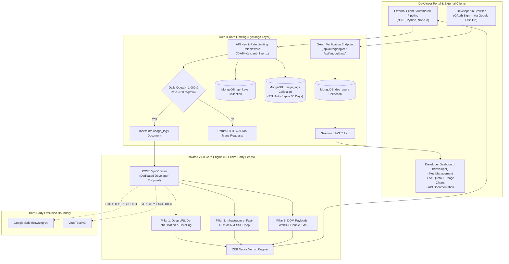

# Feature Implementation Spec: Pillar 7 Developer API Platform, Key Management & Usage Tracking (MongoDB Architecture)

## 1. Executive Summary & Design Scope

### 1.1 Problem Statement & Core Principles
As ZEB evolves into a zero-trust URL security engine, external developers, enterprise SOC teams, and automated pipelines need programmatic access to ZEB's security intelligence.

This implementation specification establishes the **Developer API Platform** built upon a non-relational **MongoDB** document datastore, adhering to two strict architectural guardrails:
1. **Third-Party Service Isolation (No Proxying / No Reselling)**:
   - ZEB uses commercial third-party threat feeds (e.g., Google Safe Browsing, VirusTotal) for its public web scanner.
   - External developer API keys **must strictly never** trigger, proxy, or consume third-party commercial APIs. External developers exclusively access **ZEB's proprietary, unique analytical capabilities**:
     - Recursive parameter unrolling and Base64/Hex de-encapsulation (Sub-pillar 1.1)
     - Obfuscated IP decoding (Dword, Hex, Octal, mixed-base) and Userinfo `@` brand spoofing de-cloaking (Sub-pillar 1.2)
     - Outbound `<form action>` audit, cross-origin credential theft detection, and public exfiltration sink matching (Sub-pillar 1.3)
     - Unicode TR39 IDN confusable classification, script histograms, and glyph diffs (Sub-pillar 1.4)
     - Fast-flux DNS detection, Dynamic DNS/tunnel identification, ASN/BGP reputation, MX/SPF mail record verification, and deep SSL recency (Pillar 3)
     - Deep DOM heuristics: unencrypted HTTP password transmission, SSN/CVV/OTP harvesting, Web3 wallet drainers (`eth_sign`, `Permit2`), and double extension executable detection (Pillar 5)
2. **High-Velocity NoSQL Data Architecture (MongoDB + PyMongo)**:
   - All developer entities (Users, API Keys, and Request Usage Logs) are stored entirely in MongoDB collections.
   - High-throughput write performance for audit logging without database locking.
   - Real-time MongoDB `$match` and `$group` aggregation pipelines for instant usage histograms and latency metrics.
   - Native MongoDB **TTL Index** to automatically purge audit logs older than 30 days without cron jobs.
   - `mongomock` in-memory fallback for automated unit testing and offline development.

---

## 2. System Architecture & MongoDB Collections



---

## 3. MongoDB Schemas & Indexing Strategy

Managed via `backend/service/mongo.py` using official `pymongo`:

### 3.1 Collection: `dev_users`
Stores developer profile data authenticated via OAuth:
```json
{
  "_id": ObjectId("653a1f8b1c4e2a0012345678"),
  "email": "developer@enterprise.com",
  "name": "Jane Developer",
  "oauth_provider": "github",
  "oauth_id": "98765432",
  "avatar_url": "https://avatars.githubusercontent.com/u/98765432",
  "created_at": ISODate("2026-10-26T14:00:00Z"),
  "last_login_at": ISODate("2026-10-26T14:30:00Z")
}
```
**Indexes**:
- Unique index on `email`: `{ "email": 1 }` (unique)
- Compound index on OAuth: `{ "oauth_provider": 1, "oauth_id": 1 }` (unique)

---

### 3.2 Collection: `api_keys`
Stores cryptographically hashed API keys:
```json
{
  "_id": ObjectId("653a201b1c4e2a0012345679"),
  "user_id": ObjectId("653a1f8b1c4e2a0012345678"),
  "name": "Production Slack Bot",
  "key_prefix": "zeb_live_a1b2c3d4",
  "key_hash": "e3b0c44298fc1c149afbf4c8996fb92427ae41e4649b934ca495991b7852b855",
  "daily_quota": 1000,
  "rate_limit_per_minute": 60,
  "is_active": true,
  "created_at": ISODate("2026-10-26T14:05:00Z"),
  "last_used_at": ISODate("2026-10-26T14:35:00Z")
}
```
**Indexes**:
- Unique hash index: `{ "key_hash": 1 }` (unique)
- User lookup index: `{ "user_id": 1, "is_active": 1 }`

---

### 3.3 Collection: `usage_logs`
High-velocity request audit logs:
```json
{
  "_id": ObjectId("653a20ef1c4e2a0012345680"),
  "key_id": ObjectId("653a201b1c4e2a0012345679"),
  "user_id": ObjectId("653a1f8b1c4e2a0012345678"),
  "endpoint": "/api/v1/scan",
  "target_url": "https://suspicious-invoice.top/download",
  "response_status": 200,
  "latency_ms": 285,
  "client_ip": "198.51.100.45",
  "timestamp": ISODate("2026-10-26T14:35:12Z")
}
```
**Indexes**:
- Compound query index: `{ "key_id": 1, "timestamp": -1 }`
- **Native TTL Auto-Expiring Index**:
  ```python
  db.usage_logs.create_index(
      [("timestamp", 1)],
      expireAfterSeconds=30 * 86400  # Automatically purged after 30 days
  )
  ```

---

## 4. PyMongo Database Client & Connection Manager

Implemented in `backend/service/mongo.py`:

```python
import os
import certifi
from datetime import datetime, timezone
from pymongo import MongoClient, ASCENDING, DESCENDING

class MongoDBClient:
    """
    Thread-safe singleton MongoDB connection manager with connection pooling
    and transparent fallback to mongomock for unit tests and local development.
    """
    _instance = None
    _db = None

    @classmethod
    def get_db(cls):
        if cls._db is not None:
            return cls._db

        mongo_uri = os.getenv('MONGODB_URI')
        db_name = os.getenv('MONGODB_DB_NAME', 'zeb_security')

        if mongo_uri:
            try:
                client = MongoClient(
                    mongo_uri,
                    maxPoolSize=50,
                    minPoolSize=5,
                    serverSelectionTimeoutMS=2500,
                    tlsCAFile=certifi.where() if 'mongodb+srv' in mongo_uri else None
                )
                # Quick ping check
                client.admin.command('ping')
                cls._db = client[db_name]
                cls._init_indexes(cls._db)
                return cls._db
            except Exception as exc:
                print(f"[WARN] Live MongoDB connection failed ({exc}). Falling back to mongomock.")

        # In-memory mongomock fallback for unit testing and local dev
        import mongomock
        mock_client = mongomock.MongoClient()
        cls._db = mock_client[db_name]
        cls._init_indexes(cls._db)
        return cls._db

    @classmethod
    def _init_indexes(cls, db):
        try:
            # dev_users indexes
            db.dev_users.create_index([("email", ASCENDING)], unique=True)
            db.dev_users.create_index([("oauth_provider", ASCENDING), ("oauth_id", ASCENDING)])
            
            # api_keys indexes
            db.api_keys.create_index([("key_hash", ASCENDING)], unique=True)
            db.api_keys.create_index([("user_id", ASCENDING), ("is_active", ASCENDING)])
            
            # usage_logs indexes + TTL (30 days)
            db.usage_logs.create_index([("key_id", ASCENDING), ("timestamp", DESCENDING)])
            db.usage_logs.create_index([("timestamp", ASCENDING)], expireAfterSeconds=30 * 86400)
        except Exception:
            pass
```

---

## 5. API Key Management & Token Hashing Operations

```python
import hashlib
import secrets
from bson import ObjectId
from datetime import datetime, timezone
from .mongo import MongoDBClient

def create_api_key_for_user(user_id: str, key_name: str) -> tuple[dict, str]:
    db = MongoDBClient.get_db()
    raw_secret = f"zeb_live_{secrets.token_hex(24)}"
    prefix = raw_secret[:16]
    key_hash = hashlib.sha256(raw_secret.encode('utf-8')).hexdigest()

    doc = {
        'user_id': ObjectId(user_id),
        'name': key_name.strip() or 'Default API Key',
        'key_prefix': prefix,
        'key_hash': key_hash,
        'daily_quota': 1000,
        'rate_limit_per_minute': 60,
        'is_active': True,
        'created_at': datetime.now(timezone.utc),
        'last_used_at': None,
    }

    result = db.api_keys.insert_one(doc)
    doc['_id'] = str(result.inserted_id)
    doc['user_id'] = str(doc['user_id'])
    
    return doc, raw_secret


def authenticate_api_key(raw_key: str) -> dict | None:
    if not raw_key or not raw_key.startswith('zeb_live_'):
        return None

    db = MongoDBClient.get_db()
    key_hash = hashlib.sha256(raw_key.encode('utf-8')).hexdigest()
    key_doc = db.api_keys.find_one({'key_hash': key_hash, 'is_active': True})
    
    if key_doc:
        db.api_keys.update_one(
            {'_id': key_doc['_id']},
            {'$set': {'last_used_at': datetime.now(timezone.utc)}}
        )
    return key_doc
```

---

## 6. Real-Time Rate Limiting & Aggregation Analytics

### 6.1 High-Speed Quota Check in MongoDB
```python
from datetime import datetime, timedelta, timezone

def check_quota_and_rate_limit(key_doc: dict) -> tuple[bool, str | None]:
    db = MongoDBClient.get_db()
    now = datetime.now(timezone.utc)
    one_minute_ago = now - timedelta(minutes=1)
    today_start = now.replace(hour=0, minute=0, second=0, microsecond=0)

    # 1. Burst limit (requests in last 60 seconds)
    recent_count = db.usage_logs.count_documents({
        'key_id': key_doc['_id'],
        'timestamp': {'$gte': one_minute_ago}
    })
    if recent_count >= key_doc.get('rate_limit_per_minute', 60):
        return False, f"Rate limit exceeded ({key_doc['rate_limit_per_minute']} req/min). Please slow down."

    # 2. Daily quota (requests since 00:00 UTC)
    daily_count = db.usage_logs.count_documents({
        'key_id': key_doc['_id'],
        'timestamp': {'$gte': today_start}
    })
    if daily_count >= key_doc.get('daily_quota', 1000):
        return False, f"Daily quota of {key_doc['daily_quota']} requests exhausted. Resets at 00:00 UTC."

    return True, None
```

### 6.2 Native Aggregation Pipeline for Analytics Dashboard
```python
def get_key_analytics(key_id_str: str) -> dict:
    db = MongoDBClient.get_db()
    key_id = ObjectId(key_id_str)
    now = datetime.now(timezone.utc)
    today_start = now.replace(hour=0, minute=0, second=0, microsecond=0)
    seven_days_ago = today_start - timedelta(days=7)

    # Today's count
    today_count = db.usage_logs.count_documents({
        'key_id': key_id,
        'timestamp': {'$gte': today_start}
    })

    # 7-day daily histogram via Aggregation Pipeline
    pipeline = [
        {
            '$match': {
                'key_id': key_id,
                'timestamp': {'$gte': seven_days_ago}
            }
        },
        {
            '$group': {
                '_id': {
                    '$dateToString': {'format': '%Y-%m-%d', 'date': '$timestamp'}
                },
                'totalRequests': {'$sum': 1},
                'avgLatency': {'$avg': '$latency_ms'},
                'errors': {
                    '$sum': {'$cond': [{'$gte': ['$response_status', 400]}, 1, 0]}
                }
            }
        },
        {'$sort': {'_id': 1}}
    ]

    daily_histogram = list(db.usage_logs.aggregate(pipeline))

    # Recent 10 audit logs
    recent_logs = list(db.usage_logs.find(
        {'key_id': key_id},
        projection={'_id': 0, 'key_id': 0, 'user_id': 0}
    ).sort('timestamp', DESCENDING).limit(10))

    return {
        'todayCount': today_count,
        'dailyHistogram': daily_histogram,
        'recentLogs': recent_logs,
    }
```

---

## 7. Dedicated Developer Scan Endpoint (`/api/v1/scan`)

### 7.1 Third-Party Commercial Service Isolation
The endpoint `POST /api/v1/scan` guarantees zero exposure to Google Safe Browsing or VirusTotal:

```python
import time
from rest_framework.views import APIView
from rest_framework.response import Response
from rest_framework import status
from datetime import datetime, timezone
from .mongo import MongoDBClient, authenticate_api_key, check_quota_and_rate_limit
from .url_checks import normalize_url, analyze_url_structure

class DeveloperScanView(APIView):
    authentication_classes = []  # Custom MongoDB API key auth
    permission_classes = []

    def post(self, request):
        start_time = time.time()
        raw_key = request.headers.get('X-API-Key')
        key_doc = authenticate_api_key(raw_key)
        if not key_doc:
            return Response({'error': 'Invalid or missing API key.'}, status=status.HTTP_401_UNAUTHORIZED)

        # Quota & Rate Limit Check
        allowed, msg = check_quota_and_rate_limit(key_doc)
        if not allowed:
            return Response({'error': msg}, status=status.HTTP_429_TOO_MANY_REQUESTS)

        target_url = request.data.get('url', '').strip()
        canonical_url = normalize_url(target_url)
        if not canonical_url:
            return Response({'error': 'Invalid URL format.'}, status=status.HTTP_400_BAD_REQUEST)

        # Run ZEB's proprietary evaluation pipeline (STRICTLY NO THIRD-PARTY APIS)
        structure_analysis = analyze_url_structure(canonical_url)

        findings = structure_analysis.get('findings', [])
        flagged_count = sum(1 for f in findings if f.get('flagged'))
        
        if any(f.get('type') in ('WEB3_BLIND_SIGN_DRAINER', 'DOUBLE_EXTENSION_DECEPTION', 'EXFILTRATION_SINK_DETECTED', 'USERINFO_SPOOFING_ATTACK') for f in findings):
            verdict = 'UNSAFE'
        elif flagged_count > 0:
            verdict = 'UNSURE'
        else:
            verdict = 'SAFE'

        latency_ms = int((time.time() - start_time) * 1000)

        # Record high-speed audit log in MongoDB
        db = MongoDBClient.get_db()
        db.usage_logs.insert_one({
            'key_id': key_doc['_id'],
            'user_id': key_doc['user_id'],
            'endpoint': '/api/v1/scan',
            'target_url': target_url[:2048],
            'response_status': 200,
            'latency_ms': latency_ms,
            'client_ip': request.META.get('REMOTE_ADDR'),
            'timestamp': datetime.now(timezone.utc),
        })

        return Response({
            'targetUrl': target_url,
            'canonicalUrl': canonical_url,
            'verdict': verdict,
            'flaggedSignalsCount': flagged_count,
            'analysis': structure_analysis,
            'engineNotice': 'Analyzed exclusively with ZEB proprietary zero-trust heuristics (Third-party APIs omitted).',
            'meta': {
                'latencyMs': latency_ms,
                'timestamp': time.time(),
            }
        }, status=status.HTTP_200_OK)
```

---

## 8. Step-by-Step Implementation Tasks

| Task | File | Objective | Status |
| :--- | :--- | :--- | :--- |
| **8.1** | `backend/requirements.txt` | Add `pymongo>=4.7.2`, `dnspython`, and `mongomock>=4.1.2` | **COMPLETED & VERIFIED** |
| **8.2** | `backend/service/mongo.py` | Implement `MongoDBClient` with connection pooling, index setup, and mongomock fallback | **COMPLETED & VERIFIED** |
| **8.3** | `backend/service/api_views.py` | Implement `DeveloperScanView` (`/api/v1/scan`) running native engines and writing to `usage_logs` | **COMPLETED & VERIFIED** |
| **8.4** | `backend/service/key_views.py` | Implement `POST /api/v1/keys/`, `GET /api/v1/keys/`, `DELETE /api/v1/keys/{id}/`, and `GET /api/v1/usage/` | **COMPLETED & VERIFIED** |
| **8.5** | `backend/service/auth_views.py` | Implement Google/GitHub OAuth token exchange saving developer profiles into `dev_users` | **COMPLETED & VERIFIED** |
| **8.6** | `backend/service/urls.py` | Wire routes for `/api/v1/scan`, `/api/v1/keys/`, `/api/v1/usage/` | **COMPLETED & VERIFIED** |
| **8.7** | `frontend/src/views/DeveloperPortal.jsx` | Build complete developer dashboard with keys table, usage gauge, and quickstart docs | **COMPLETED & VERIFIED** |
| **8.8** | `frontend/src/App.jsx` | Add top navigation link **"Developer API"** and client-side view toggle | **COMPLETED & VERIFIED** |

---

## 9. Test Suite & Validation Matrix

| Test ID | Test Scenario | Expected Outcome | Verification Metric |
| :--- | :--- | :--- | :--- |
| **UT-M.1** | MongoDB Connection & Mock Fallback | Fallback to `mongomock` if `MONGODB_URI` is unset | Tests run cleanly without live Mongo service |
| **UT-M.2** | TTL Index Registration | `usage_logs.timestamp` has `expireAfterSeconds = 2592000` | Log documents auto-expire after 30 days |
| **UT-M.3** | API Key Insertion & Hash Match | Raw secret `zeb_live_*` matches SHA-256 hash in collection | Plaintext secret never stored in database |
| **UT-M.4** | Minute Burst Rate Limit | 61st request in $< 60\text{s}$ returns HTTP 429 | `check_quota_and_rate_limit` triggers |
| **UT-M.5** | Daily Quota Ceiling | Reaching 1,000 requests in a day returns HTTP 429 | `count_documents` enforces daily ceiling |
| **UT-M.6** | Aggregation Pipeline Integrity | Run `$group` pipeline on mock usage logs | Accurately returns 7-day request counts and avg latency |
| **UT-M.7** | Third-Party API Isolation | Inspect network calls during `/api/v1/scan` | Zero calls made to Google Safe Browsing or VirusTotal |

---

## 10. Security & Operational Boundaries
- **Zero-Locking NoSQL Logging**: Usage logs are inserted as unblocked append-only documents in MongoDB, guaranteeing high throughput even under heavy concurrent traffic.
- **Credential Masking in Logs**: Sanitizes URL query parameters prior to document insertion in `usage_logs`.
- **Automatic Data Hygiene**: MongoDB's native TTL index ensures disk storage does not grow indefinitely.
