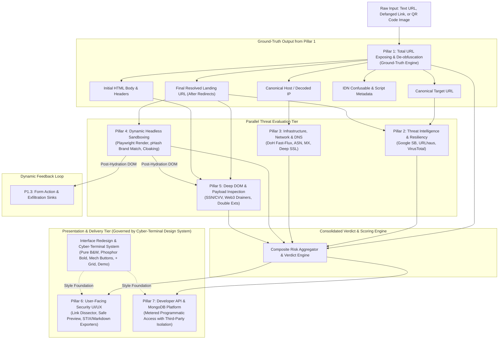
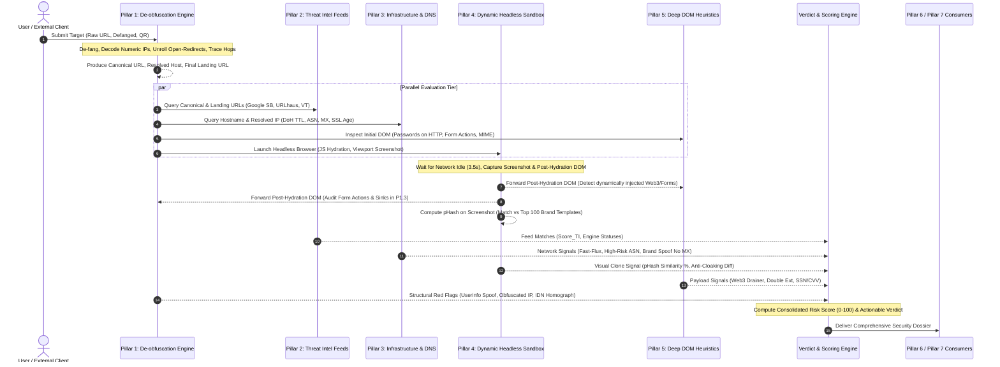
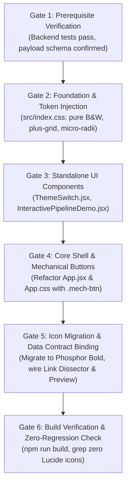

# ZEB Architecture & Implementation Overview: 7-Pillar Interdependence & Execution Order

## 1. Executive Architecture Map

The ZEB Zero-Trust Link Security Platform is organized into seven specialized security pillars. Each pillar addresses a distinct attack surface, ranging from low-level URL de-obfuscation to headless browser dynamic analysis and metered programmatic API access.



---

## 2. Pillar Interdependence Matrix

Understanding the data dependencies between pillars is essential for correct pipeline execution. Downstream evaluation engines cannot produce reliable results if upstream de-obfuscation is incomplete or inaccurate.

| Pillar | Depends On (Inputs) | Feeds Into (Outputs) | Nature of Dependency |
| :--- | :--- | :--- | :--- |
| **Pillar 1: Total URL Exposing** | Raw user/API input | **Pillars 2, 3, 4, 5, 6, 7** | **Absolute Prerequisite (Ground-Truth Producer)**: Strips obfuscated IPs (Dword/Octal/Hex), resolves open redirects, and unpacks nested parameters. If Pillar 1 does not unroll `bit.ly/xyz` into `evil.com`, all downstream engines will inspect Bitly rather than the real threat. |
| **Pillar 2: Threat Intelligence** | Canonical URL & Final Landing (from P1) | **Verdict Engine, Pillar 6** | **External Reputation Feed**: Concurrently queries Google Safe Browsing, URLhaus, and VirusTotal with circuit breakers. Excluded from Pillar 7 by design. |
| **Pillar 3: Infrastructure & DNS** | Canonical Hostname & Resolved IP (from P1) | **Verdict Engine, Pillar 6, Pillar 7** | **Network Provenance**: Evaluates DNS TTL (Fast-Flux), Dynamic DNS, ASN reputation, and SSL recency based on the host isolated by Pillar 1. |
| **Pillar 4: Dynamic Sandboxing** | Final Resolved Landing URL (from P1) | **Pillar 1.3 (DOM X-Ray), Pillar 5 (DOM Heuristics), Pillar 6 (UI Preview)** | **Hydration & Visual Analysis**: Executes client-side JavaScript in a Playwright container. Feeds post-hydration DOM back into Pillar 1.3 and Pillar 5, and yields the screenshot for Pillar 4.2 (pHash) and Pillar 6.2 (Safe Preview). |
| **Pillar 5: Deep DOM & Payloads** | Raw DOM (from P1) OR Hydrated DOM (from P4) | **Verdict Engine, Pillar 6, Pillar 7** | **Behavioral Threat Detector**: Inspects DOM markup for unencrypted passwords, SSN/CVV theft, Web3 wallet drainers (`eth_sign`, `Permit2`), and double extension download traps. |
| **Pillar 6: User-Facing UI/UX & Cyber-Terminal Interface** | Output from **Pillars 1, 2, 3, 4, 5** & **Interface Redesign Plan** | End User / Browser | **Human Comprehension & Design System Layer**: Transforms analytical threat telemetry into high-contrast monochrome cyber-terminal cards, the interactive Link Dissector, isolated cloud preview, inline animated pipeline demo, and STIX 2.1 / Markdown incident dossiers. |
| **Pillar 7: Developer API Platform** | Native Engines (**Pillars 1, 3, 5**) | External API Integrations | **Metered Distribution Layer**: Exposes dedicated `POST /api/v1/scan` backed by MongoDB keys, quotas (1,000/day), and usage tracking, with strict isolation that **excludes Pillar 2**. |

---

## 3. Detailed Data Contract & Flow Diagram



---

## 4. Strict Implementation Order (Phasing & Dependencies)

To guarantee that each component has its required dependencies available upon implementation, the pillars must be developed and integrated in the following sequence:

```mermaid
flowchart LR
    Phase1["Phase 1: Pillar 1<br/>De-obfuscation & Ground Truth<br/>(Prerequisite for everything)"] --> Phase2["Phase 2: Pillar 2<br/>Threat Intel & Resiliency<br/>(Fixes fatal 500/502 panics)"]
    Phase2 --> Phase3["Phase 3: Pillar 3<br/>Infrastructure & DNS<br/>(Network & host profiling)"]
    Phase3 --> Phase4["Phase 4: Pillar 5<br/>Deep DOM & Payloads<br/>(Content, Web3 & MIME)"]
    Phase4 --> Phase5["Phase 5: Pillar 4<br/>Dynamic Sandbox & Vision<br/>(Heavyweight JS & pHash)"]
    Phase5 --> Phase6["Phase 6: Pillar 6<br/>User-Facing UI/UX<br/>(Dissector, Preview & Export)"]
    Phase6 --> Phase7["Phase 7: Pillar 7<br/>Developer API & MongoDB<br/>(Programmatic distribution)"]
```



### Phase 1: Pillar 1 (Total URL Exposing & De-obfuscation) [COMPLETED & VERIFIED]
- **Why First**: Pillar 1 is the foundational ground-truth engine. Every single downstream component (DNS queries, WHOIS, threat intelligence, DOM parsing, and UI tokens) relies on having the de-obfuscated canonical URL, decoded IP, and unrolled redirect target.
- **Key Modules**:
  - `decode_obfuscated_ip()` (Dword, Hex, Octal, mixed-base)
  - `unpack_nested_url_parameters()` (Base64/Hex/URL recursive unroller)
  - `extract_and_audit_userinfo()` (de-cloaking `user@host` deception)
  - `analyze_idn_homographs()` (TR39 confusable classification)
  - `refang_url()` & `defang_url()`
  - Loop-safe HTTP/Meta-Refresh/JS redirect traversal engine with SSRF IP guards
- **Specification Document**: [`docs/implementation/features/pillar-1-url-exposing-and-deobfuscation.md`](file:///home/temesgensida/tom/django_react/zeb/docs/implementation/features/pillar-1-url-exposing-and-deobfuscation.md)

---

### Phase 2: Pillar 2 (Multi-Engine Threat Intelligence & Zero-Panic Resiliency) [COMPLETED & VERIFIED]
- **Why Second**: The current codebase suffers from a critical architectural defect where a missing Google Safe Browsing API key or an HTTP 429 quota exhaustion immediately crashes the entire backend with an HTTP 500 or 502 error. Fixing this immediately stabilizes the core pipeline before adding further inspection modules.
- **Key Modules**:
  - `ThreatIntelManager` with `ThreadPoolExecutor(max_workers=3)`
  - Resilient wrappers for Google Safe Browsing, URLhaus (Abuse.ch), and VirusTotal
  - Thread-safe in-memory TTL quota cache (SHA-256 indexed)
  - Circuit breakers mapping errors to `RATE_LIMITED` / `UNAVAILABLE` without crashing
- **Specification Document**: [`docs/implementation/features/pillar-2-multi-engine-threat-intel.md`](file:///home/temesgensida/tom/django_react/zeb/docs/implementation/features/pillar-2-multi-engine-threat-intel.md)

---

### Phase 3: Pillar 3 (Infrastructure, Network & DNS Threat Evaluation) [COMPLETED & VERIFIED]
- **Why Third**: Builds directly on the canonical hostname and resolved IP address produced by Phase 1. Operates at the network layer, querying DNS-over-HTTPS (DoH), BGP autonomous systems, and SSL certificates independently of page HTML content.
- **Key Modules**:
  - Zero-dependency DNS-over-HTTPS resolver via Cloudflare and Google DoH JSON
  - Fast-Flux detection (TTL $< 60$s across rotating multi-subnet IPs)
  - Dynamic DNS (`duckdns.org`, `no-ip.com`) and reverse tunnel (`ngrok`, `loca.lt`) filters
  - IP-to-ASN resolver flagging bulletproof hosting networks
  - Mail infrastructure audit (flagging brand impersonators with no MX records)
  - Deep SSL recency inspector (flagging certificates issued $< 24$ hours ago)
- **Specification Document**: [`docs/implementation/features/pillar-3-infrastructure-network-dns.md`](file:///home/temesgensida/tom/django_react/zeb/docs/implementation/features/pillar-3-infrastructure-network-dns.md)

---

### Phase 4: Pillar 5 (Deep DOM, Form Action & Payload Inspection) [COMPLETED & VERIFIED]
- **Why Fourth**: Analyzes the static HTML body retrieved during the redirect traversal phase. Operates as a fast, pure-Python behavioral inspection layer before introducing heavier dynamic headless browser dependencies.
- **Key Modules**:
  - Insecure password guard (flags password inputs on HTTP origins)
  - Sensitive identity harvesting patterns (SSN, Credit Card CVV, 2FA/OTP tokens, Banking PINs)
  - Transparent clickjacking overlay detection (`opacity: 0`, elevated `z-index`)
  - Web3 cryptocurrency wallet drainer signatures (`eth_sign`, `setApprovalForAll`, `Permit2`)
  - Drive-by download sniffer and double extension detector (`.pdf.exe`)
- **Specification Document**: [`docs/implementation/features/pillar-5-deep-dom-payload-inspection.md`](file:///home/temesgensida/tom/django_react/zeb/docs/implementation/features/pillar-5-deep-dom-payload-inspection.md)

---

### Phase 5: Pillar 4 (Dynamic Headless Sandboxing & Visual Threat Detection) [COMPLETED & VERIFIED]
- **Why Fifth**: Extends the static inspection tier by executing client-side JavaScript in an isolated Playwright browser container. Consumes the landing URL from Phase 1, yields post-hydration DOM back into Phase 1.3 and Phase 4, and captures the screenshot used for visual brand matching and UI previews.
- **Key Modules**:
  - Isolated Playwright container worker with stealth anti-detection patches
  - Network request harvester intercepting background `fetch` and WebSocket exfiltration
  - Perceptual hashing (`pHash` / `dHash`) visual matcher comparing against top 100 brand login templates
  - Differential multi-vantage prober (Desktop Chrome vs Mobile Safari iOS vs Webmail referer)
  - Zero-panic fallback to static analysis if Playwright is offline
- **Specification Document**: [`docs/implementation/features/pillar-4-dynamic-sandboxing-visual-threats.md`](file:///home/temesgensida/tom/django_react/zeb/docs/implementation/features/pillar-4-dynamic-sandboxing-visual-threats.md)

---

### Phase 6: Pillar 6 (User-Facing Security UI/UX Improvements & Cyber-Terminal Interface Overhaul) [COMPLETED & VERIFIED]
- **Why Sixth**: Presents the data generated by all analytical engines (Pillars 1 through 5) in a visual, actionable format for human users. This phase unifies the analytical threat visualizations with the complete **Cyber-Terminal Interface Redesign System**.
- **Key Modules & Specifications**:
  - **Sub-phase 6.1 (Brand & Design System Foundations)**:
    - **`ZEB`***Security* brand typography lockup: upright heavy bold grotesque **`ZEB`** paired with an italicized slanted descriptor ***`Security`*** and an engineered circuit glyph prefix.
    - Pure high-contrast black (`#000000`) and white (`#FFFFFF`) palette with isolated functional risk accents (Emerald, Amber, Rose Red).
    - Open-canvas plus-sign (`+`) grid backdrop with a top-to-bottom radial gradient mask for high hero texture and effortless text legibility.
    - Precision 2px–4px micro-radius geometry on interactive inputs, buttons, and control widgets.
    - Tactile mechanical button physics: solid `2px 2px 0px` hard offset shadow and active `translate(2px, 2px)` depression.
  - **Sub-phase 6.2 (Cardless Editorial Layout & Navigation)**:
    - Removal of the outer `<main className="card">` container; adoption of an open-canvas editorial hierarchy with clean unboxed typography and hairline divider rules.
    - Clean underlined editorial tabs directly on the canvas (`[ Scan Telemetry | How ZEB Inspects | FAQ ]`).
    - Dual-segment rectangular sliding theme switcher (`[ Sun LIGHT | Moon DARK ]`).
    - Full migration to `@phosphor-icons/react` using `weight="bold"` across all components.
  - **Sub-phase 6.3 (Interactive Threat Demonstration)**:
    - Inline interactive demonstration card (`InteractivePipelineDemo.jsx`) with 3 selectable real-world scenarios (*Clean Domain*, *Obfuscated Phish*, *Web3 Drainer*).
  - **Sub-phase 6.4 (Security Feature Visualizations)**:
    - Interactive "Link Dissector" component (color-coded tokens with educational popovers).
    - Isolated Cloud Preview modal (sanitized screenshot viewer with zoom/pan).
    - De-scripted "Safe Text Mode" reader with highlighted phishing lure phrases.
    - One-click defanged URL copy (`hxxps[://]...`).
    - Formatted Markdown threat dossier exporter & structured STIX 2.1 / JSON threat bundle generator.
- **Specification Documents**:
  - Feature Specification: [`docs/implementation/features/pillar-6-user-facing-security-ui-ux.md`](file:///home/temesgensida/tom/django_react/zeb/docs/implementation/features/pillar-6-user-facing-security-ui-ux.md)
  - UI/UX Design System Specification: [`docs/implementation/interface/interface-redesign-plan.md`](file:///home/temesgensida/tom/django_react/zeb/docs/implementation/interface/interface-redesign-plan.md)

---

### Phase 7: Pillar 7 (Developer API Platform & MongoDB Usage Tracking) [COMPLETED & VERIFIED]
- **Why Seventh**: Packages the completed proprietary inspection engines into a programmatic API platform for external consumers. Requires that the core native engines (Pillars 1, 3, and 5) are fully functional and properly isolated from third-party commercial APIs (Pillar 2).
- **Key Modules**:
  - MongoDB integration via official `pymongo` with `mongomock` testing fallback
  - Collections: `dev_users`, `api_keys` (SHA-256 hashed), and `usage_logs`
  - Native MongoDB 30-day auto-expiring TTL index on request logs
  - Rate limiting ($60\text{ req/min}$) and daily quotas ($1,000\text{ req/day}$)
  - Dedicated developer endpoint `POST /api/v1/scan` with **strict third-party API exclusion**
  - Developer portal at `/developer` with OAuth2 sign-in (Google/GitHub) and live usage charts
- **Specification Document**: [`docs/implementation/features/pillar-7-developer-api-and-usage-tracking.md`](file:///home/temesgensida/tom/django_react/zeb/docs/implementation/features/pillar-7-developer-api-and-usage-tracking.md)

---

## 5. Architectural Invariants & Cross-Cutting Rules

Every engineering implementation across all pillars must enforce four non-negotiable architectural invariants:

1. **The Zero-Panic Guarantee**:
   - An external API failure, network timeout, rate limit (`HTTP 429`), malformed DNS record, or missing environment variable must **never** cause the backend to raise an uncaught exception or return HTTP 500/502.
   - All external calls must degrade gracefully into structured error metadata, allowing remaining pipeline stages to complete.

2. **SSRF & Network Boundary Immunity**:
   - At every network step (redirect unrolling, DoH queries, headless browsing, asset crawling), the destination IP address must be validated prior to connection.
   - Connections to private subnets (`127.0.0.0/8`, `10.0.0.0/8`, `172.16.0.0/12`, `192.168.0.0/16`, `169.254.169.254`, `fc00::/7`) must be aborted immediately with an explicit security finding.

3. **Strict Third-Party API Isolation for Developer API**:
   - Requests arriving via `X-API-Key` at `POST /api/v1/scan` must **never** trigger Google Safe Browsing, VirusTotal, or any commercial third-party service.
   - External developers pay for/consume ZEB's proprietary analytical intelligence only; ZEB will never serve as an open proxy for third-party commercial vendors.

4. **Bounded Execution Timeouts**:
   - Every individual external request must specify an explicit timeout ceiling:
     - Threat Intel feeds: $\le 2.0\text{s}$ per feed
     - DNS-over-HTTPS queries: $\le 1.5\text{s}$
     - ASN lookup: $\le 1.8\text{s}$
     - TLS socket handshake: $\le 2.0\text{s}$
     - Headless Playwright scan: $\le 4.0\text{s}$
   - Total pipeline execution duration must not exceed $7.5\text{ seconds}$.


---

## 6. Agent Execution Playbook: Applying the Interface Redesign Post-Feature Implementation

When implementing ZEB, an AI agent or engineer must strictly observe the boundary between **Feature Engine Construction** (Phases 1–5) and **Visual Interface Overhaul** (Phase 6).

### 6.1 Phase Boundary Rule
> [!IMPORTANT]
> **Do not begin frontend interface restyling until backend feature endpoints and data contracts are tested and returning live payload structures.**
> 
> Applying visual styling over placeholder or changing backend contracts leads to repeated regressions. Complete the data engines first, then execute the interface overhaul with guaranteed telemetry bindings.

### 6.2 Sequential Gate-by-Gate Agent Playbook



#### Gate 1: Prerequisite Verification
- Verify that Django backend test suite passes: `python backend/manage.py test service`.
- Ensure `POST /api/check-url/` returns the full multi-engine payload schema:
  - De-obfuscated canonical URL, unrolled hops, decoded numeric IPs.
  - DNS-over-HTTPS Fast-Flux, ASN reputation, SSL age.
  - Deep DOM heuristics (insecure passwords, Web3 drainer signatures, MIME traps).
  - Headless screenshot data URI (when Playwright is enabled).

#### Gate 2: Foundation & Token Injection
- Edit [`frontend/src/index.css`](file:///home/temesgensida/tom/django_react/zeb/frontend/src/index.css):
  - Replace legacy charcoal tokens with monochrome variables (`--mono-0` through `--mono-100`).
  - Add the open-canvas 24px repeating plus-sign (`+`) inline SVG pattern with a top-to-bottom radial gradient mask on `.page::before`.
  - Set micro-radius variables: `--radius-xs: 2px`, `--radius-sm: 3px`, `--radius-md: 4px`.
  - Define tactile mechanical button variables (`--mech-shadow-light: 2px 2px 0px #000000`, `--mech-shadow-dark: 2px 2px 0px #FFFFFF`).

#### Gate 3: Standalone UI Components
- Create [`frontend/src/components/ThemeSwitch.jsx`](file:///home/temesgensida/tom/django_react/zeb/frontend/src/components/ThemeSwitch.jsx):
  - Rectangular dual-segment toggle with smooth sliding indicator block and ARIA radio semantics.
  - Bold `Sun` and `Moon` icons from `@phosphor-icons/react`.
- Create [`frontend/src/components/InteractivePipelineDemo.jsx`](file:///home/temesgensida/tom/django_react/zeb/frontend/src/components/InteractivePipelineDemo.jsx):
  - 3 pre-loaded scenarios (*Clean Domain*, *Obfuscated Phish*, *Web3 Drainer*).
  - Terminal input bar with dynamic risk score tag.
  - Interactive clickable pipeline nodes demonstrating multi-tier protection.

#### Gate 4: Core Shell & Mechanical Buttons
- Update [`frontend/src/App.css`](file:///home/temesgensida/tom/django_react/zeb/frontend/src/App.css):
  - Remove outer card wrapper styles; implement `.layout-shell` for an open-canvas editorial reading layout.
  - Implement **`ZEB`***Security* brand typography (bold upright + italic descriptor).
  - Implement `.editorial-tabs-bar` and unboxed text section styling with clean hairline divider rules.
  - Implement `.mech-btn` and `.mech-btn-secondary` classes with 2px hard shadow offset and `translate(2px, 2px)` active depression.
  - Restyle search input bar and test sample pills with 2px–4px micro-radii and 1px crisp borders.
  - Update multi-stage progress stepper and risk gauge dial to high-contrast monochrome tracks with isolated functional risk colors.

#### Gate 5: Phosphor Icon Migration & Data Contract Binding
- In [`frontend/src/App.jsx`](file:///home/temesgensida/tom/django_react/zeb/frontend/src/App.jsx):
  - Remove all `react-icons/lu` imports.
  - Import all icons from `@phosphor-icons/react` using `weight="bold"`.
  - Mount `<ThemeSwitch theme={theme} toggleTheme={toggleTheme} />` in the header bar.
  - Mount `<InteractivePipelineDemo />` directly below the search form.
  - Mount `.editorial-tabs-bar` with `Scan Telemetry`, `How ZEB Inspects`, and `FAQ` tabs.
  - Bind Pillar 6 security feature modules:
    - Interactive Link Dissector (URL tokenization).
    - Isolated Cloud Preview modal.
    - STIX 2.1 / Markdown export buttons.

#### Gate 6: Build Verification & Zero-Regression Check
- Execute production build in `frontend/`:
  ```bash
  npm run build
  ```
- Run static checks:
  ```bash
  # Verify 0 Lucide icon imports remain
  grep -rn "react-icons/lu" frontend/src/ || echo "PASS: No Lucide icons remaining"
  ```
- Manually inspect in browser:
  - Toggle light/dark mode: sliding thumb moves smoothly; 100% monochrome canvas with 0 color leaks.
  - Press mechanical buttons: crisp 2px depression and shadow collapse with immediate spring-back.
  - Interact with pipeline demo: scenario tabs dynamically update target URL, score, and stage states.
